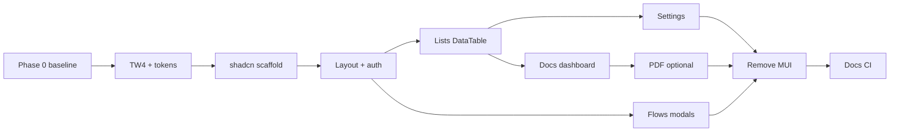

# Frontend UI migration: Tailwind 4 + shadcn/ui (doc-orchestrator alignment)

**Status:** **Active** — next frontend initiative on `main` (Vite/Next migration is complete).

**Companion:** sibling repo **doc-orchestrator** (`../doc-orchestrator`) — reference implementation for Tailwind 4, shadcn/ui (Base UI), CSS design tokens, and `DataTable`.

**Prerequisite (done):** [Vite migration plan](../vite_migration_plan.md) — SPA on Vite + React Router, merged to `main`.

---

## 1. Why migrate

| Layer | doc-router today (`packages/typescript/frontend`) | Target (orchestrator) |
|-------|---------------------------------------------------|------------------------|
| CSS | Tailwind **3.4**, `tailwind.config.ts`, PostCSS | Tailwind **4.3**, `@tailwindcss/postcss`, CSS-first `styles.css` + shadcn |
| Colors | `brandPalette.ts` + mixed `primary-*` / legacy `blue-*` | CSS variables (`--primary`, `--brand`, …) + semantic utilities |
| Primitives | **MUI**, **Headless UI**, raw HTML | **`src/components/ui/*`** (shadcn, **@base-ui/react**) |
| Tables | MUI X Data Grid, react-table in places | **TanStack Table** + shadcn `Table` (`DataTable`) |
| Icons | MUI, Heroicons, FontAwesome | **lucide-react** (incrementally) |
| Toasts | react-hot-toast + react-toastify | **sonner** (shadcn wrapper) |
| Theme | MUI `ThemeProvider` + `theme.ts` | Tokens only; no MUI theme |

Orchestrator documents the intended look in **`../doc-orchestrator/docs/design/ui.md`** (token values derived from doc-router’s legacy blues, not ad-hoc Databricks lava in a stale `:root` block). Use **ui.md §3** as the default token table when implementing doc-router.

**Non-goals for early phases:** rewiring **Formio**, **React Flow** canvas internals, or **Monaco** — keep them working; restyle application chrome around them.

---

## 2. Target end state

- **One styling system:** Tailwind 4 + shadcn/ui, copied into `src/components/ui`. No new MUI/Headless UI after Phase 2.
- **Semantic colors only** in app code: `bg-background`, `bg-brand`, `bg-primary`, `text-muted-foreground`, `border-input`, etc.
- **Branding:** keep existing `APP_NAME` / `APP_FAVICON` / `publicEnv.ts`; map **visual** defaults to CSS tokens (runtime branding API optional later, as orchestrator’s `BrandingTheme`).
- **PDF viewer:** either a late dedicated port or a documented MUI “island” until replaced.

---

## 3. Phased plan

### Phase 0 — Baseline — **complete** (`frontend-shadcn`)

- Branch **`frontend-shadcn`** from `main`.
- Inventory (grep, 2026-03): **~42** files import `@mui/material`; **~18** use `@headlessui`; heaviest MUI in **PDFViewer** and org list grids.
- Smoke checklist: [`vite_smoke_test_5173.md`](../vite_smoke_test_5173.md) (re-run after UI phases).

---

### Phase 1 — Tailwind 4 + design tokens — **complete**

1. **`tailwindcss@4.3`** + **`@tailwindcss/postcss`** (Vite `postcss.config.mjs`; Formio `index.css` in `main.tsx` + Vite `formioTailwindReference` plugin; `postinstall` patches TW3 `@apply` in `@tsed/tailwind-formio`).
2. **`src/styles.css`**: `@import "tailwindcss"`, `@config` → existing `tailwind.config.ts` (spacing/fonts/`primary-*` scale), `@theme inline` semantic colors from **ui.md §3**.
3. **`main.tsx`**: `styles.css` → shell → Formio theme → formio overrides → markdown.
4. **Bridge:** legacy `primary-*` / `blue-*` still from `tailwind.config.ts` + `brandPalette.ts`; semantic `bg-background`, `bg-brand`, `text-muted-foreground`, etc. available for Phase 3.

**Exit:** ✅ `npm run build` + `npm run typecheck`.

**Deferred (later phases):** drop `tailwind.config.ts` body into pure `@theme`; remove `brandPalette.ts`; Layout on `bg-brand` / `primary-soft`.

---

### Phase 2 — shadcn scaffold — **complete**

- `components.json` — **base-nova**, lucide, `src/styles.css`
- `styles.css`: `tw-animate-css`, `shadcn/tailwind.css`; shadcn `--primary` / `--secondary` tokens
- `src/lib/utils.ts` (`cn`); `src/components/ui/*` (mirrored from orchestrator; CLI blocked on legacy npm peer resolution)
- **Sonner** + `TooltipProvider` in `AppProviders.tsx` (legacy hot-toast / toastify kept until Phase 4+)
- Demo: **`/dev/ui-kit`** (`UiKitDemoPage`)

**Exit:** ✅ build + typecheck.

---

### Phase 3 — Vertical slice: shell + auth — **complete** (`frontend-shadcn`)

| Area | Action |
|------|--------|
| `Layout.tsx` | Orchestrator-style shell: `bg-brand`, sidebar `primary-soft` active state, lucide nav, shadcn `Button` / `Tooltip` |
| `OrganizationSwitcher`, `UserMenu` | Headless `Menu` → `DropdownMenu` |
| `pages/auth/signin.tsx` | shadcn `Field` + `Input` + `Button` |
| `Home.tsx` | `Card` + token typography |

**Exit:** ✅ auth + signed-in chrome without MUI/Headless in these files.

---

### Phase 4 — Standard CRUD lists (2–3 weeks, repeatable) — **in progress**

**Tags (`frontend-shadcn`):** ✅ orchestrator list stack; create via dialog; `/tags/:tagId` edit unchanged.

**Prompts (`frontend-shadcn`):** ✅ same list stack; `TagCell` + tag filter popover; rename/clone via `FormDialog`; create stays `?tab=prompt-create` (Monaco).

**Schemas (`frontend-shadcn`):** ✅ `DataTable` + `autoRowHeight` fields column; rename/clone with name uniqueness; create stays `?tab=schema-create`.

**Forms (`frontend-shadcn`):** ✅ `DataTable` + `TagCell`; rename/clone with name uniqueness; create stays `?tab=form-create` (Form.io builder).

**Cases (`frontend-shadcn`):** ✅ `DataTable` + `FilterBuilder` + React Query (`useOrgCases`); `TagCell`; metadata search field; `PageHeader`; create stays `?tab=case-create`. Delete dialog still MUI (Phase 4/6).

**Knowledge bases (`frontend-shadcn`):** ✅ `DataTable` + filters + `useOrgKnowledgeBases` (polling while indexing); `TagCell`; `ConfirmDialog` delete; KB detail tabs unchanged; properties modal still MUI.

Per entity (start with **Tags** or **Prompts**):

1. List: MUI Data Grid → orchestrator-style **DataTable** (TanStack Table + shadcn table)
2. Modals: MUI `Dialog` → shadcn `Dialog`
3. Page headers: shared `PageHeader` pattern

Roll through: cases, schemas, forms, prompts, knowledge bases.

**Exit:** at least one org hub area with zero MUI on list + create/edit modals.

---

### Phase 5 — Settings + admin (1–2 weeks)

Settings layout, users, orgs, license, development/LLM screens — shadcn form controls (`Field`, `Select`, `Switch`, `Tabs`); density per ui.md (`text-sm`, `h-9`).

---

### Phase 6 — Documents + dashboard (1–2 weeks)

Dashboard, document list, upload (keep react-dropzone), bulk-run dialogs — Headless → shadcn `Dialog` / `Progress`.

**Progress on `frontend-shadcn` (documents):**

- ✅ Org + case document lists → `OrgDocumentList` + `DataTable` + `FilterBuilder` + React Query (`useOrgDocuments`, `useOrgAllTags`)
- ✅ Row actions: `PropertiesDialog`, shadcn `DocumentUpdate` / `DocumentRename` slide-over & modal; tags via `TagCheckboxList` (no autocomplete)
- ✅ Bulk actions sheet (`DocumentBulkUpdate`): inset panel, confirm dialogs, bulk tag add/remove checklists
- ✅ Bulk LLM/OCR/Flows: single tag via shadcn `TagSelect` / `SingleTagSelector` wrapper
- ✅ Upload wizard: shadcn controls + `TagCheckboxList`; removed legacy MUI `DocumentList.tsx`
- ✅ Org dashboard: `PageHeader`, shadcn `Card`/`Button`, Lucide, React Query counts + `TagBadge`
- ⏳ Tour guide; case delete / KB info modals; PDF viewer (Phase 8)

---

### Phase 7 — Flows UI (2–4 weeks, separate track)

Keep **React Flow**. Replace Headless in flow modals, palettes, settings (`FlowNodeConfigModal`, etc.) with shadcn `Dialog` / `Popover` / `Tabs`.

---

### Phase 8 — PDF viewer (2+ weeks or hybrid)

`PDFViewer.tsx` is deeply MUI.

- **Recommended:** MUI **island** until Phases 3–6 complete; toolbar port optional.
- **Full port:** align with orchestrator `PdfViewer` when resourced.

---

### Phase 9 — Remove legacy UI packages (~1 week)

When grep-clean: remove `@mui/*`, `@emotion/*`, `@headlessui/react`, redundant icon packs, duplicate toast libs, `ThemeShell` / `theme.ts`.

**Exit:** `package.json` dependency story matches orchestrator’s “one styling system” rule.

---

### Phase 10 — Docs & CI

- Update [CLAUDE.md](../../CLAUDE.md) frontend section.
- Link from [vite_migration_plan.md](../vite_migration_plan.md).
- CI: `typecheck` + `build`; watch CSS bundle size.

---

## 4. Dependency graph (suggested order)

---

## 5. Upfront decisions

1. **Token defaults:** legacy doc-router blue (ui.md §3) vs operator white-label — defaults in CSS; optional runtime branding later.
2. **Toolchain bump:** schedule **Vite 8 / React 19** with Phase 1 or as a pre-step (orchestrator already there).
3. **Allowed islands:** rule after Phase 2 — **no new MUI/Headless**; Formio / React Flow / Monaco / PDF exempt until their phase.

---

## 6. Rough effort (one full-time frontend dev)

| Scope | Estimate |
|-------|----------|
| Phases 0–3 (TW4, tokens, shadcn, shell, auth) | 3–4 weeks |
| Phases 4–6 (lists, settings, docs; no PDF/flows) | +4–6 weeks |
| Phases 7–9 (flows, PDF, package removal) | +4–8 weeks |

**First mergeable milestone:** Phases **0 + 1 + 2 + 3** — ✅ on `frontend-shadcn` (Form.io TW4 fix landed separately on same branch).

---

## 7. References

| Resource | Path |
|----------|------|
| Orchestrator UI spec (tokens, rules) | `../doc-orchestrator/docs/design/ui.md` |
| Orchestrator frontend | `../doc-orchestrator/packages/typescript/frontend/` |
| Orchestrator `styles.css` | `../doc-orchestrator/packages/typescript/frontend/src/styles.css` |
| Orchestrator `components.json` | `../doc-orchestrator/packages/typescript/frontend/components.json` |
| doc-router Vite entry | `packages/typescript/frontend/src/main.tsx` |
| doc-router layout | `packages/typescript/frontend/src/components/Layout.tsx` |

*Last updated: 2026-03-11 — active roadmap after Vite migration on `main`.*
