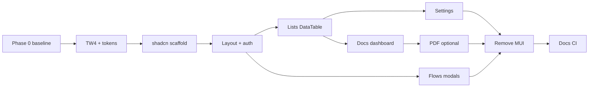

# Frontend UI migration: Tailwind 4 + shadcn/ui (doc-orchestrator alignment)

**Status:** **Active** — next frontend initiative on `main` (Vite/Next migration is complete).

**Companion:** sibling repo **doc-orchestrator** (`../doc-orchestrator`) — reference implementation for Tailwind 4, shadcn/ui (Base UI), CSS design tokens, and `DataTable`.

**Prerequisite (done):** [Vite migration plan](../vite_migration_plan.md) — SPA on Vite + React Router, merged to `main`.

---

## 1. Why migrate

| Layer | doc-router today (`packages/typescript/frontend`) | Target (orchestrator) |
|-------|---------------------------------------------------|------------------------|
| CSS | Tailwind **3.4**, `tailwind.config.ts`, PostCSS | Tailwind **4.3**, `@tailwindcss/vite`, CSS-first `styles.css` |
| Colors | `brandPalette.ts` + mixed `primary-*` / legacy `blue-*` | CSS variables (`--primary`, `--brand`, …) + semantic utilities |
| Primitives | **MUI**, **Headless UI**, raw HTML | **`src/components/ui/*`** (shadcn, **@base-ui/react**) |
| Tables | MUI X Data Grid, react-table in places | **TanStack Table** + shadcn `Table` (`DataTable`) |
| Icons | MUI, Heroicons, FontAwesome | **lucide-react** (incrementally) |
| Toasts | react-hot-toast + react-toastify | **sonner** (shadcn wrapper) |
| Theme | MUI `ThemeProvider` + `theme.ts` | Tokens only; no MUI theme |

Orchestrator documents the intended look in **`../doc-orchestrator/docs/design/ui.md`** (token values derived from doc-router’s legacy blues, not ad-hoc Databricks lava in a stale `:root` block). Use **ui.md §3** as the default token table when implementing doc-router.

**Non-goals for early phases:** rewiring **Formio**, **React Flow** canvas internals, or **Monaco** — keep them working; restyle application chrome around them.

---

## 2. Target end state

- **One styling system:** Tailwind 4 + shadcn/ui, copied into `src/components/ui`. No new MUI/Headless UI after Phase 2.
- **Semantic colors only** in app code: `bg-background`, `bg-brand`, `bg-primary`, `text-muted-foreground`, `border-input`, etc.
- **Branding:** keep existing `APP_NAME` / `APP_FAVICON` / `publicEnv.ts`; map **visual** defaults to CSS tokens (runtime branding API optional later, as orchestrator’s `BrandingTheme`).
- **PDF viewer:** either a late dedicated port or a documented MUI “island” until replaced.

---

## 3. Phased plan

### Phase 0 — Baseline (½–1 day)

- Branch (e.g. `frontend-shadcn` from `main`).
- Inventory: ~40+ files import `@mui/material`; ~18 use `@headlessui`; heavy MUI in **PDFViewer** and list screens.
- Route checklist + screenshots: sign-in, org dashboard, documents, one settings page, flows list, PDF doc viewer.
- Note orchestrator toolchain versions to align when upgrading: `tailwindcss@4.3`, `@tailwindcss/vite`, `shadcn@4`, `vite@8`, `react@19` (doc-router may upgrade Vite/React during Phase 1).

**Exit:** checklist and “before” screenshots attached to the epic/PR.

---

### Phase 1 — Tailwind 4 + design tokens (1–2 weeks)

1. Add `@tailwindcss/vite`; upgrade to **Tailwind 4**.
2. Introduce central `src/styles.css` (or equivalent):
   - `@import "tailwindcss"`
   - `@import "shadcn/tailwind.css"` (once Phase 2 init exists; TW4-only sub-step acceptable first)
   - `@theme inline { … }` mapping variables to utilities
3. Set **`:root` tokens** from orchestrator **ui.md §3** (doc-router legacy blues), e.g.:
   - `--brand: #0078d4` — header band (legacy `bg-blue-600`)
   - `--primary: #0754a6` — primary actions
   - `--primary-soft: #e6f0fa` — sidebar active / soft highlights
   - `--background` / `--card` — page gray + white panels
4. **Bridge:** map existing `primary-*` utilities to token-backed theme during transition, or accept a short freeze on new raw color classes.
5. **Formio:** preserve import order in `main.tsx` (Formio CSS, custom overrides) **after** the global sheet; smoke one form builder + renderer.
6. Remove `brandPalette.ts` and MUI palette coupling when tokens are authoritative.

**Exit:** `npm run build` + dev smoke; Layout header/sidebar use semantic classes with visual parity to legacy blue chrome.

---

### Phase 2 — shadcn scaffold (2–4 days)

Mirror orchestrator `packages/typescript/frontend`:

- `components.json` — style **base-nova**, lucide, `@/lib/utils`, CSS path → `styles.css`
- CLI init + core primitives: `button`, `input`, `label`, `field`, `card`, `dialog`, `dropdown-menu`, `tooltip`, `tabs`, `badge`, `alert`, `sonner`, `spinner`, `separator`
- `cn` + `lib/utils.ts`
- Wire **sonner** in app root; no new usage of dual toast libraries

**Exit:** demo route or internal page proving Button / Dialog / Input with tokens.

---

### Phase 3 — Vertical slice: shell + auth (~1 week)

| Area | Action |
|------|--------|
| `Layout.tsx` | Orchestrator-style shell: `bg-brand`, sidebar `primary-soft` active state, lucide nav, shadcn `Button` / `Tooltip` |
| `OrganizationSwitcher`, `UserMenu` | Headless `Menu` → `DropdownMenu` |
| `pages/auth/signin.tsx` | shadcn `Field` + `Input` + `Button` |
| `Home.tsx` | `Card` + token typography |

**Exit:** auth + signed-in chrome without MUI/Headless in these files.

---

### Phase 4 — Standard CRUD lists (2–3 weeks, repeatable)

Per entity (start with **Tags** or **Prompts**):

1. List: MUI Data Grid → orchestrator-style **DataTable** (TanStack Table + shadcn table)
2. Modals: MUI `Dialog` → shadcn `Dialog`
3. Page headers: shared `PageHeader` pattern

Roll through: cases, schemas, forms, prompts, knowledge bases.

**Exit:** at least one org hub area with zero MUI on list + create/edit modals.

---

### Phase 5 — Settings + admin (1–2 weeks)

Settings layout, users, orgs, license, development/LLM screens — shadcn form controls (`Field`, `Select`, `Switch`, `Tabs`); density per ui.md (`text-sm`, `h-9`).

---

### Phase 6 — Documents + dashboard (1–2 weeks)

Dashboard, document list, upload (keep react-dropzone), bulk-run dialogs — Headless → shadcn `Dialog` / `Progress`.

---

### Phase 7 — Flows UI (2–4 weeks, separate track)

Keep **React Flow**. Replace Headless in flow modals, palettes, settings (`FlowNodeConfigModal`, etc.) with shadcn `Dialog` / `Popover` / `Tabs`.

---

### Phase 8 — PDF viewer (2+ weeks or hybrid)

`PDFViewer.tsx` is deeply MUI.

- **Recommended:** MUI **island** until Phases 3–6 complete; toolbar port optional.
- **Full port:** align with orchestrator `PdfViewer` when resourced.

---

### Phase 9 — Remove legacy UI packages (~1 week)

When grep-clean: remove `@mui/*`, `@emotion/*`, `@headlessui/react`, redundant icon packs, duplicate toast libs, `ThemeShell` / `theme.ts`.

**Exit:** `package.json` dependency story matches orchestrator’s “one styling system” rule.

---

### Phase 10 — Docs & CI

- Update [CLAUDE.md](../../CLAUDE.md) frontend section.
- Link from [vite_migration_plan.md](../vite_migration_plan.md).
- CI: `typecheck` + `build`; watch CSS bundle size.

---

## 4. Dependency graph (suggested order)

---

## 5. Upfront decisions

1. **Token defaults:** legacy doc-router blue (ui.md §3) vs operator white-label — defaults in CSS; optional runtime branding later.
2. **Toolchain bump:** schedule **Vite 8 / React 19** with Phase 1 or as a pre-step (orchestrator already there).
3. **Allowed islands:** rule after Phase 2 — **no new MUI/Headless**; Formio / React Flow / Monaco / PDF exempt until their phase.

---

## 6. Rough effort (one full-time frontend dev)

| Scope | Estimate |
|-------|----------|
| Phases 0–3 (TW4, tokens, shadcn, shell, auth) | 3–4 weeks |
| Phases 4–6 (lists, settings, docs; no PDF/flows) | +4–6 weeks |
| Phases 7–9 (flows, PDF, package removal) | +4–8 weeks |

**First mergeable milestone:** Phases **0 + 1 + 2 + 3** (TW4, tokens matching legacy blues, shadcn init, Layout + sign-in).

---

## 7. References

| Resource | Path |
|----------|------|
| Orchestrator UI spec (tokens, rules) | `../doc-orchestrator/docs/design/ui.md` |
| Orchestrator frontend | `../doc-orchestrator/packages/typescript/frontend/` |
| Orchestrator `styles.css` | `../doc-orchestrator/packages/typescript/frontend/src/styles.css` |
| Orchestrator `components.json` | `../doc-orchestrator/packages/typescript/frontend/components.json` |
| doc-router Vite entry | `packages/typescript/frontend/src/main.tsx` |
| doc-router layout | `packages/typescript/frontend/src/components/Layout.tsx` |

*Last updated: 2026-03-11 — active roadmap after Vite migration on `main`.*
