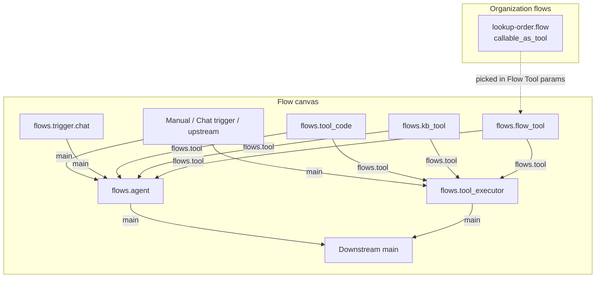

Implementation plan for an **AI Agent** flow node modeled on [n8n's AI Agent](https://docs.n8n.io/integrations/builtin/cluster-nodes/root-nodes/n8n-nodes-langchain.agent/tools-agent/) (Tools Agent). The agent orchestrates an LLM tool-calling loop and connects to tools via a dedicated **tool connector**. **Memory is out of scope for v1.**

**Implementation lives in** the [`doc-router`](https://github.com/analytiq-hub/doc-router) product repo. This document is the product/engineering spec; user-facing behavior will be summarized in [DocRouter Flows]({{ '/docs/flows/' | relative_url }}) once shipped.

**Status (2026-06-27):** Phases **B** and **C** are complete. **E** and **F** are partial (core UX shipped). **D** remains partial (`flow_picker` UI). Path B tool testing (**`ToolTestArgsModal`**) is **done**. Main gaps: §15 integration tests and §19 user-facing docs. See [§2.2](#22-implementation-progress) and [§2.3](#23-recommended-next-work).

**Reference (behavior only — do not copy naming or LangChain coupling):**

| n8n concept | DocRouter v1 equivalent |
|-------------|-------------------------|
| AI Agent root node | `flows.agent` |
| `ai_tool` connection | `flows.tool` port type |
| Code Tool sub-node | `flows.tool_code` |
| Knowledge Base Tool sub-node | `flows.kb_tool` (RAG search against an org knowledge base) |
| Workflow Tool sub-node | `flows.flow_tool` (org-scoped flat flow picker) |
| Tool test / direct dispatch | `flows.tool_executor` (n8n `PartialExecutionToolExecutor` semantics, **persisted** on canvas) |
| Execute step on tool node | `rewire_graph_for_tool_test()` + **`ToolTestArgsModal`** (Path B — shipped) |
| Chat Trigger | `flows.trigger.chat` (Phase F) |
| Chat Trigger → Agent streaming | Agent `enable_streaming` + chunked NDJSON response (Phase F) |
| `ai_memory` connection | **Not in v1** |
| `ai_languageModel` sub-node | Inline model parameters on the agent (v1); optional dedicated port in v2 |
| Human review for tool calls | **Not in v1** — all wired tools execute immediately; gated approval in v2 |

---

## 1. Goals

1. **Agent node on the canvas** — rectangular configurable node (n8n-style ~224×96px) with main input/output and a **tool input connector** on the bottom edge.
2. **Tool connector** — typed port `flows.tool`; only tool-capable nodes may connect; an agent may wire **multiple** tools (unbounded tool inputs, same pattern as `flows.merge` unbounded main inputs).
3. **Tool Code node** — new `flows.tool_code` node that exposes sandboxed Python as a named LLM tool the agent can call.
4. **Knowledge Base Tool node** — new `flows.kb_tool` node that exposes hybrid KB search as a named LLM tool (same `search_knowledge_base` contract as document RAG and KB chat).
5. **Tool Executor node** — n8n-aligned tool consumer on the **main path** so **`flows.trigger.manual` can run tools** without an LLM (`Manual trigger → Tool Executor → tool`). Same dispatch contract as n8n’s `PartialExecutionToolExecutor`, but saved on the canvas instead of injected only at execute-step.
6. **Dedicated flow agent loop** — implement a **new** tool-calling loop under `analytiq_data/flows/agent_loop/`, purpose-built for batch flow execution. **Do not refactor or share** `analytiq_data/agent/agent_loop.py` with the document agent.
7. **Chat Trigger + streaming agent (Phase F)** — `flows.trigger.chat` as the conversational entry point (n8n Chat Trigger parity); optional **streaming** LLM output when `response_mode: streaming` and the downstream agent has streaming enabled.

### Non-goals (v1)

- Memory / conversation-history connector (`ai_memory` equivalent).
- Separate LLM sub-node on the canvas (model chosen in agent parameters).
- MCP client/server integration.
- Exposing the full Document Agent tool registry (`get_schema`, `create_prompt`, …) as flow tools — those remain document-chat scoped unless explicitly added later.
- KB management as flow tools (create/update/delete KBs, reconcile) — v1 exposes **search only** via `flows.kb_tool`.
- Output parser sub-node (structured output via agent `response_schema` parameter instead).
- Human-in-the-loop approval UI mid-flow-run — flow loop runs to completion (see §7.6.3).
- Refactoring, extracting, or unifying with `agent/agent_loop.py` — the two loops evolve independently.
- **Flow subfolders / folder tree** — organization scoping is sufficient for v1; flows are listed and picked within the current org only (no nested folder hierarchy).

---

## 2. Current state

| Area | Before this plan | As of 2026-06-27 (latest) |
|------|------------------|---------------------------|
| Flow connection types | `main`, `docrouter.ocr` only | `main`, `docrouter.ocr`, **`flows.tool`** |
| Agentic loop | Document Agent (`agent_loop.py`) — chat UI, not a flow node | **`analytiq_data/flows/agent_loop/`** + **`flows.agent`** node; document agent unchanged |
| Code node | `flows.code` — transforms items; not an LLM tool | `flows.code` + **`flows.tool_code`** (`def run(params, context)`) |
| Flow list | Flat table; no `callable_as_tool` filter | Flat table; **`callable_as_tool`** metadata on `FlowHeader`; org-scoped **`GET /flows?callable_as_tool=true`** for pickers |
| Composite / sub-workflow | Manifest stub only | **`flows.flow_tool`** + **`flows.trigger.tool`** / **`flows.respond_to_tool`** sub-execution runtime |
| Chat entry | — | **`flows.trigger.chat`** + **`POST …/flows/{id}/chat`** (production) + **`POST …/chat/test`** (editor snapshot); **`FlowEditorChatPanel`** |
| Manual chat test (Execute flow) | — | Chat Trigger **`initial_messages`** fallback when `chatInput` empty on manual runs |
| Palette | No `ai` section | **`ai`** section in backend + frontend; **`FlowNodePalette` buckets derived from section order** |
| Execution log (agent) | — | **`agent_tool_calls`** in Trace tab (`FlowLogsPanel`, `flowNodeTracePanel`) |
| Tool test (Path B) | — | **`ToolTestArgsModal`** + `tool_test_request` on `POST …/run`; `prepare_tool_test_run()` in worker; inline **Result** after run; tool `run_data` mirrored from Tool Executor dispatch |

**Key files to extend:**

| Layer | Path |
|-------|------|
| SDK types | `packages/typescript/sdk/src/types/flows.ts` |
| Port helpers | `packages/typescript/sdk/src/flow-port-types.ts`, `packages/python/analytiq_data/flows/port_types.py` |
| Engine validation | `packages/python/analytiq_data/flows/engine.py` |
| Canvas handles | `packages/typescript/frontend/src/components/flows/FlowCanvasNode.tsx` |
| Connection rules | `packages/typescript/frontend/src/components/flows/FlowEditor.tsx` |
| Palette sections (`ai` group — **new**) | `packages/python/analytiq_data/flows/palette_groups.py`, `packages/typescript/frontend/src/components/flows/flowPaletteGroups.ts`, `packages/python/tests/flows/test_palette_groups.py`, `packages/python/tests/flows/test_all_nodes_palette_group.py` |
| Flow agent loop (new) | `packages/python/analytiq_data/flows/agent_loop/` |
| Document agent loop (unchanged) | `packages/python/analytiq_data/agent/agent_loop.py` |
| Code sandbox | `packages/python/analytiq_data/flows/nodes/code.py`, `code_runner/` |

### 2.1 Document agent vs flow agent loop

Both use LiteLLM function-calling under the hood, but they are **separate implementations**:

| Concern | Document agent (`agent/agent_loop.py`) | Flow agent (`flows/agent_loop/`) |
|---------|----------------------------------------|----------------------------------|
| Entry point | `run_agent_turn`, `run_agent_approve` | `FlowAgentLoop.run()` |
| Trigger | HTTP chat / SSE | `FlowsAgentNode.execute()` |
| Tools | Fixed registry (`tool_registry.py`) | Wired canvas nodes (`tool_code`, `kb_tool`, `flow_tool`) |
| Context | `document_id`, `working_state`, mentions | `FlowItem`, `ExecutionContext`, upstream `nodes` |
| System prompt | `build_system_message()` (document-scoped) | Node `system_message` parameter (+ expressions) |
| Pause / resume | `set_turn_state` + approve endpoint | **None in v1** — runs to completion or error |
| Streaming | SSE chunks to browser | NDJSON streaming backend + **editor chat test panel** (`FlowEditorChatPanel.tsx`); production `/chat` requires active flow |
| SPU operation | `agent_llm` | `flow_agent_llm` |
| Tests | `tests/agent/test_agent_loop.py` | `tests/flows/test_flow_agent_loop.py` |

**Shared infrastructure only** (not shared loop code): `ad.llm.agent_completion`, `ad.payments.*`, LiteLLM model/key resolution — same as `docrouter.llm_run` uses today.

### 2.2 Implementation progress

Phases **B** and **C** are **complete**. **E** and **F** have landed core UX; **D** still needs the flat **`flow_picker`** widget. §15 tests remain the main quality gap before calling v1 done.

| Phase | Status | Shipped | Remaining |
|-------|--------|---------|-----------|
| **B — Tool port + Tool Code + Tool Executor** | **Done** | `flows.tool` SDK/engine/canvas; `tool_provider` / `tool_consumer` flags; `tool_wiring.py`; `flows.tool_code`, `flows.tool_executor`; `dispatch.execute_tool_call()`; Path B `rewire_graph_for_tool_test()` + **execute-step UI**; **`ai` palette section** | — |
| **C — Agent loop + Agent + KB Tool** | **Done** | `flows/agent_loop/` (`loop.py`, `dispatch.py`, `billing.py`, `stream.py`); `flows.agent`, `flows.kb_tool`; `test_flow_agent_loop.py`, `test_flows_tool_graph.py`; **`llm_model_picker`** + **`knowledge_base_picker`** widgets via SDK | Dedicated tests: `test_flows_agent_node.py`, `test_flows_kb_tool.py`, `test_flows_tool_executor.py` (planned in §15) |
| **D — Flow Tool** | Partial | `callable_as_tool` on `FlowHeader`; `flows.flow_tool`, `flows.trigger.tool`, `flows.respond_to_tool`; sub-flow stack + timeout in engine | **`flow_picker`** widget (flat org-scoped search); callable-flow validation on activate |
| **E — Polish** | Partial | **Agent tool trace** in logs Trace tab (`agent_tool_calls` via `flowNodeIoPreview`, `flowNodeTracePanel`, `FlowLogsPanel`) | Pin data support for agent node; canvas badge polish for tool rounds |
| **F — Chat Trigger + streaming** | Partial | `flows.trigger.chat`; `ExecutionContext.is_streaming` + `stream_sink`; streaming in `FlowAgentLoop`; `app/routes/flow_chat.py` (`/chat` + **`/chat/test`**); **`FlowEditorChatPanel.tsx`** (toolbar **Test chat**); SDK `runFlowChatTest` + `streamNdjson`; manual-run **`initial_messages`** → `chatInput` fallback; multi-turn stream fixes | **F.1:** embed widget, file uploads, session history / memory; KB streaming QA |

**Frontend widgets (§13):**

| Widget / UI | Status | Notes |
|-------------|--------|-------|
| `flows.tool` handles + edge rules | Done | Amber `in-tool` bus handle; tool out on providers |
| `llm_model_picker` | Done | `flowOrgApi.listLLMModels({ excludeEmbeddings: true })`; SDK `ListOrgLLMModelsParams` |
| `knowledge_base_picker` | Done | `flowOrgApi.listKnowledgeBases`; active KBs only |
| `tool_name_input` | Partial | Freetext placeholder; wired-tool dropdown deferred |
| Agent / Tool Executor canvas layout | Done | Rectangular nodes; tool connector styling |
| Chat Trigger test panel | **Done** | `FlowEditorChatPanel.tsx`; streams NDJSON; focuses logs on `meta.execution_id` |
| Execution log agent tool trace | **Done** | Trace tab shows `agent_tool_calls` (args, preview, duration, success) |
| Flow picker widget | Not started | Flat org-scoped list; `callable_as_tool` flows only |
| Execute-step Path B modal | **Done** | `ToolTestArgsModal.tsx` (`z-[260]` above node config); args JSON + pin load + **Result** panel; **Run again** / **Close**; canvas + node modal **Execute step** on `tool_provider` |

**Review fixes applied during implementation:** palette bucket init for `ai` section; org LLM models API `exclude_embeddings` param; SDK build required for frontend picker types; logs panel min expanded height; chat stream `end`/`meta` events + guaranteed stream close on execution finalize; `busy` cleared on `end` so multi-turn test chat works; Path B modal z-index above node config; tool test modal stays open with inline result.

### 2.3 Recommended next work

Priority order to finish v1:

1. **`flow_picker` widget** (Phase D) — searchable flat list of `callable_as_tool` flows in the current org.
2. **Callable-flow validation on activate** — reject activate when `callable_as_tool` flow lacks `flows.trigger.tool` + `flows.respond_to_tool`.
3. **§15 test suites** — especially `test_flow_chat_trigger.py` (HTTP), `test_flows_kb_tool.py`, `test_flows_tool_executor.py`, `test_flow_agent_loop_streaming.py`.
4. **Pin data for agent node** (Phase E remainder).
5. **§19 user-facing docs** — Flows node table, Document Agent vs `flows.agent`, streaming chatbot tutorial.
6. **F.1 deferred** — public embed widget, chat file uploads, session history / memory connector.

**Shippable demo flows (manual QA):**

| Flow | Status |
|------|--------|
| Manual → Tool Executor → Tool Code | Ready (Path A) |
| Tool Code / KB Tool via **Execute step** on tool node | Ready (Path B — **Test tool arguments** modal) |
| Chat Trigger → AI Agent → Tool Code | Ready via **Test chat** panel + Execute flow (`initial_messages`) |
| Chat Trigger → AI Agent → KB Tool (streaming) | Ready via Test chat; needs QA with real KB |
| Chat Trigger → AI Agent → Flow Tool | Blocked on **`flow_picker`** UI |

---

## 3. Architecture overview



**Execution model (high level):**

1. Agent node receives items on **main** input (same item shape: `json`, `binary`, `meta`, `paired_item`).
2. At **graph compile** time, the engine collects all nodes connected to the agent's tool port(s) and builds a **tool registry** for that agent instance (name, description, JSON Schema, dispatch target node id).
3. At **runtime**, for each item (or batched per `mode`), the agent runs a bounded tool-calling loop (default max 10 rounds, matching document agent).
4. When the LLM emits a tool call, the engine executes the wired tool node **synchronously** in-process (tool code subprocess or child flow execution), returns JSON to the LLM, and continues until a final assistant message or max rounds.
5. Agent emits output items on **main** with structured fields (see §7.3).

The **flow agent loop** (§7.6) is the runtime core; `FlowsAgentNode` is a thin adapter that maps items ↔ loop config ↔ output items.

---

## 4. Flow organization (out of scope for v1)

**Decision:** Do **not** implement flow subfolders or a folder tree. **Organization** is the namespace — all flows, credentials, and KBs already belong to one org; that boundary is sufficient for v1.

Implications:

- **`FlowList`** stays a flat, paginated table scoped to the current org.
- **`flow_picker`** (Flow Tool parameter widget) is a **flat, searchable list** of flows in the org where `callable_as_tool: true` — same pattern as n8n’s sub-workflow picker (project-wide search, no folder paths).
- No `flow_folders` collection, `folder_id` on flow headers, or folder CRUD in this plan.
- If hierarchical grouping is needed later, treat it as a **separate v2** feature; it is not a prerequisite for Flow Tool or the agent node.

---

## 5. New connection type: `flows.tool`

### 5.1 Wire format

Extend `FlowConnectionType`:

```typescript
export type FlowConnectionType = 'main' | 'docrouter.ocr' | 'flows.tool';
```

Persisted connection (unchanged shape):

```json
{
  "dest_node_id": "agent-1",
  "connection_type": "flows.tool",
  "index": 0
}
```

### 5.2 Port topology

| Node | Port | Position | Type | Cardinality |
|------|------|----------|------|-------------|
| `flows.agent` | tool input | bottom | `flows.tool` | unbounded (`tool_consumer`) |
| `flows.agent` | main in / main out | left / right | `main` | 1 / 1 |
| `flows.tool_executor` | tool input | bottom | `flows.tool` | unbounded (`tool_consumer`) |
| `flows.tool_executor` | main in / main out | left / right | `main` | 1 / 1 |
| `flows.tool_code` | tool out | top | `flows.tool` | 1 output port (`tool_provider`); **multiple outgoing** `flows.tool` edges to different consumers allowed |
| `flows.kb_tool` | tool out | top | `flows.tool` | 1 output port (`tool_provider`); multiple consumers allowed |
| `flows.flow_tool` | tool out | top | `flows.tool` | 1 output port (`tool_provider`); multiple consumers allowed |

**Direction:** tool providers **output** `flows.tool` → tool consumers **input** (`flows.agent` or `flows.tool_executor`).

Manifest flags:

| Flag | Nodes | Meaning |
|------|-------|---------|
| `tool_provider` | `flows.tool_code`, `flows.kb_tool`, `flows.flow_tool` | Emits `flows.tool`; skipped in main DAG |
| `tool_consumer` | `flows.agent`, `flows.tool_executor` | Accepts `flows.tool` wires; dispatches tool calls |

Validation (`engine.py`, `FlowEditor.tsx`):

- `portTypesCompatible('flows.tool', 'flows.tool')` only.
- Tool output connects only to `tool_consumer` tool input handles (not main ports).
- `tool_provider` must wire to **≥1** `tool_consumer` (agent and/or executor).
- Reject `flows.tool` edges between two `tool_provider` nodes.
- Tool port index `i` is stable per wire (execution log ordering).

**Tool input handle (decided):** one **bottom bus handle** per `tool_consumer` node (`id: in-tool`). Multiple `flows.tool` edges attach to the same handle; `connection.index` distinguishes wires (0, 1, 2, …). Do not render per-wire bottom handles in v1.

### 5.3 Canvas UI (`FlowCanvasNode.tsx`)

- Agent and Tool Executor: rectangular configurable shape (~224×96px).
- Tool connector on consumers: **single** bottom-center bus handle (`in-tool`), amber/orange accent; multiple dashed edges allowed.
- Tool providers: smaller satellite cards above the consumer, dashed `flows.tool` edges.
- Palette group **Trigger**: **Chat Trigger** (shipped — Phase F backend).
- Palette group **AI** (shipped — Phase B): Agent, **Tool Executor**, Tool Code, **Knowledge Base Tool**, Flow Tool, Respond to tool.

**`palette_group: ai` (Phase B — done):** `"ai"` is in `PALETTE_GROUP_KEYS` / `FlowPaletteSectionId` / `FLOW_PALETTE_SECTION_ORDER`. `FlowNodePalette.emptyBuckets()` is derived from section order so new groups cannot drift. AI-family manifests: `flows.agent`, `flows.tool_executor`, `flows.tool_code`, `flows.kb_tool`, `flows.flow_tool`, `flows.respond_to_tool`.

---

## 6. `flows.trigger.chat` — Chat Trigger

n8n [Chat Trigger](https://docs.n8n.io/integrations/builtin/core-nodes/n8n-nodes-langchain.chattrigger/) parity: a **conversational entry point** that receives user messages over HTTP and starts a flow run. Primary topology:

```
Chat Trigger ──main──► AI Agent ──► (optional downstream)
                           ↑ flows.tool
                      Tool Code / KB Tool / Flow Tool
```

Ships in **Phase F** (after batch agent in Phase C). Reuses existing flow sync-execution infrastructure (same family as `flows.trigger.webhook` `last_node` mode), not the async worker queue.

### 6.1 Identity

| Field | Value |
|-------|-------|
| `key` | `flows.trigger.chat` |
| `label` | Chat Trigger |
| `palette_group` | `trigger` |
| `icon_key` | `chat_trigger` |
| `is_trigger` | `true` |
| `min_inputs` / `max_inputs` | `0` / `0` |
| `outputs` | `1` (`main`) |
| `experimental` | `true` (Phase F) |

**Graph rule:** at most **one** `flows.trigger.chat` per flow revision (same pattern as one `flows.trigger.tool` on callable flows).

### 6.2 Parameters

| Parameter | Type | Default | Description |
|-----------|------|---------|-------------|
| `response_mode` | `streaming` \| `last_node` | `streaming` | How the HTTP handler returns the agent reply (see §6.4) |
| `authentication` | `none` \| `org_member` \| `api_key` | `org_member` | Who may POST chat messages |
| `title` | `string` | flow name | Chat panel / embed title |
| `subtitle` | `string` | — | Optional subtitle |
| `input_placeholder` | `string` | `Type your message…` | Input placeholder |
| `initial_messages` | `string` | — | Newline-separated bot greeting lines shown before first user turn |
| `allow_file_uploads` | `boolean` | `false` | Accept multipart file uploads with the message (Phase F.1) |

**Out of scope (Phase F):** hosted embed widget HTML (n8n `hostedChat` mode), `loadPreviousSession` / memory connector, CORS/public embed config — API + flow-editor test panel first; embed UI in Phase F.1.

### 6.3 Trigger item shape

On each user message, emit **one** item (same envelope as other triggers):

```json
{
  "json": {
    "chatInput": "What is our refund policy?",
    "action": "sendMessage"
  },
  "binary": {},
  "meta": {
    "session_id": "550e8400-e29b-41d4-a716-446655440000",
    "source_node_id": "chat-trigger-1"
  }
}
```

**Canonical session id (decided):** `meta.session_id` is the **only** session field on the flow item. Do **not** duplicate it on `json`. Downstream expressions, memory (F.1), and run logs read **`$meta.session_id`**. The HTTP API accepts `sessionId` in the POST body (camelCase, client-facing); the route normalizes it into `meta.session_id` when building the item.

| Field | Location | Source |
|-------|----------|--------|
| `chatInput` | `json` | POST body `chatInput` (required string) |
| `action` | `json` | `sendMessage` (reserved for future `loadPreviousSession`) |
| `session_id` | **`meta`** | POST body `sessionId`, or server-generated UUID when omitted |
| `source_node_id` | `meta` | Chat Trigger node id (standard trigger metadata) |

File uploads (when enabled): binaries on the item keyed by field name; `chatInput` may be empty if the user sends only files.

### 6.4 HTTP surface

| Method | Path | Purpose |
|--------|------|---------|
| `POST` | `/v0/orgs/{org_id}/flows/{flow_id}/chat` | Submit a chat message; run active revision from Chat Trigger |
| `GET` | same path | Phase F.1: serve embeddable chat page (optional) |

**Request body (JSON):**

```json
{
  "chatInput": "Hello",
  "sessionId": "optional-uuid"
}
```

(`sessionId` is the **HTTP/API** field name; it is stored on the trigger item as **`meta.session_id`** only — see §6.3.)

**`response_mode: last_node`** (buffered):

- Synchronous run (same wall-clock limits as webhook `last_node`).
- HTTP 200 with JSON envelope: `{ "text": "<agent_output>", "session_id": "<from trigger meta>", "execution_id": "…" }`.
- No token streaming; full reply available only after run completes.

**`response_mode: streaming`** (default, n8n-aligned):

- Handler opens a **long-lived chunked HTTP response** before the workflow runs (`Transfer-Encoding: chunked`, `Cache-Control: no-cache, no-transform`, `Connection: keep-alive`).
- Body is **NDJSON** — one JSON object per line, flushed as events are produced (see §7.6.11).
- Sets `ExecutionContext.is_streaming = true` and attaches `stream_sink` for the run.
- Final line includes complete `text` and `execution_id`; run_data is persisted as for batch runs.

### 6.5 Agent coupling

When Chat Trigger is the **direct main upstream** of `flows.agent`:

| Agent parameter | Default when chat-connected |
|-----------------|----------------------------|
| `prompt_source` | `chat_trigger` (new option) |
| `prompt_field` | `chatInput` (ignored when `chat_trigger`) |
| `enable_streaming` | `"auto"` when trigger `response_mode: streaming`; else `false` (`auto` → stream when `ExecutionContext.is_streaming`; see §7.2) |

New `prompt_source` value:

| Value | Behavior |
|-------|----------|
| `chat_trigger` | User message = `item.json.chatInput`; error if missing or not a string |
| `from_input` | Existing behavior — read `prompt_field` |
| `fixed` | Existing behavior — `prompt_text` |

Validation warning (non-blocking): Chat Trigger not directly wired to an agent — *"Chat Trigger is typically connected directly to an AI Agent node."*

### 6.6 Flow editor test panel — **shipped**

When a flow revision contains `flows.trigger.chat`, show a **chat panel** in the flow editor (n8n canvas chat parity):

- Uses **`POST …/flows/{id}/chat/test`** with the editor snapshot (no activation required).
- Respects trigger `response_mode` — renders streaming NDJSON incrementally when enabled.
- Does not require publishing the flow for editor testing (same auth as manual execute).

**Implementation:** `FlowEditorChatPanel.tsx` (side drawer); toolbar **Test chat** in `FlowDetailPageClient.tsx` when exactly one Chat Trigger exists. SDK: `runFlowChatTest()` + `HttpClient.streamNdjson()`. Multi-turn: `busy` clears on `end`/`error`; stream always closes even if execution finalize fails.

### 6.7 Executor (`FlowsChatTriggerNode`)

Location: `packages/python/analytiq_data/flows/nodes/trigger_chat.py`

Trigger nodes do not execute in the DAG — the **HTTP route** validates auth, builds the trigger item, and calls the flow runner with `start_node_id` = chat trigger id. The node class exists for manifest/registry parity and parameter schema only (same pattern as `flows.trigger.webhook`).

---

## 7. `flows.agent` — AI Agent node

### 7.1 Identity

| Field | Value |
|-------|-------|
| `key` | `flows.agent` |
| `label` | AI Agent |
| `palette_group` | `ai` |
| `icon_key` | `agent` (new Heroicon mapping) |
| `tool_consumer` | `true` |
| `is_merge` | `false` |
| `min_inputs` / `max_inputs` | `1` / `1` (main) + unbounded `flows.tool` |
| `outputs` | `1` |
| `input_port_types` | `["main"]` plus dynamic tool ports (see implementation note below) |
| `output_port_types` | `["main"]` |
| `experimental` | `true` (v1) |

**Implementation note:** `tool_consumer: true` on the manifest. Main input stays port index `0` (`main`); all `flows.tool` wires use the single bottom bus handle (`in-tool`) with distinct `connection.index` values. `inputPortTypes()` / `input_port_types_for()` read `tool_consumer` — no separate `tool_input_port_type` flag.

### 7.2 Parameters

| Parameter | Type | Default | Description |
|-----------|------|---------|-------------|
| `prompt_source` | `from_input` \| `fixed` \| `chat_trigger` | `from_input` | User message source; `chat_trigger` when wired from Chat Trigger (§6.5) |
| `prompt_text` | `string` | — | When `fixed`; supports `={{ ... }}` expressions |
| `prompt_field` | `string` | `query` | JSON key on input item when `from_input` |
| `system_message` | `string` | built-in | System instructions; expression-capable |
| `model` | `string` | org default | LiteLLM model id (`x-ui-widget: llm_model_picker` — **shipped**; org enabled models minus embeddings via SDK) |
| `temperature` | `number` | `0.2` | |
| `max_tool_rounds` | `integer` | `10` | Cap tool loop (1–20) |
| `mode` | `per_item` \| `all_items` | `per_item` | One agent run per item vs single run over batch |
| `response_field` | `string` | `agent_output` | Key on output item `json` for final text |
| `include_tool_trace` | `boolean` | `true` | Attach `json.agent_tool_calls` array to output |
| `enable_streaming` | `boolean` \| `auto` | `auto` | Phase F: stream LLM text deltas when resolved to `true`. `auto` (default) → `true` when `ExecutionContext.is_streaming`, else `false`. `FlowsAgentNode` resolves to `bool` before calling `FlowAgentLoop.run()`. |

**`on_error`:** inherited from the flow node instance (`stop` \| `continue`, same as all nodes). When `FlowAgentResult.error` is set, `FlowsAgentNode` fails the node if `on_error: stop` (default) or emits an error-envelope item if `continue`.

**Removed vs earlier draft:** `auto_approve` — not applicable; the flow loop has no pause/resume path in v1.

### 7.3 Output item shape

```json
{
  "json": {
    "agent_output": "Final natural language answer",
    "max_rounds_reached": false,
    "agent_tool_calls": [
      {
        "round": 1,
        "tool": "lookup_order",
        "arguments": { "order_id": "123" },
        "result_preview": "{...}",
        "duration_ms": 42
      }
    ]
  },
  "binary": {},
  "paired_item": 0
}
```

`paired_item` is an `int` or `list[int]` (input item index provenance), same as other flow nodes — not an `{ "item": … }` object.

Pass through input `binary` unless a tool explicitly adds binary (future).

### 7.4 Node executor (`FlowsAgentNode`)

Location: `packages/python/analytiq_data/flows/nodes/agent.py`

Thin adapter — no tool-calling logic here. Responsibilities:

1. Resolve parameters (expressions, `prompt_source`, model).
2. Read precomputed **`tool_consumer_wiring`** from `ExecutionContext` (see §12.1).
3. Build `FlowAgentConfig` + `WiredToolRegistry` (§7.6).
4. For each input item (or once in `all_items` mode), call `FlowAgentLoop.run(...)`.
5. Map `FlowAgentResult` → output `FlowItem`(s) with `response_field` and optional `agent_tool_calls`.

### 7.5 Graph validation (agent-specific)

- At least **zero** tools allowed (degenerates to single LLM call).
- Each wired tool node must be exactly one hop away on `flows.tool` into this agent.
- Tool names must be unique per consumer (derived from tool node `tool_name` parameter); duplicate names → validation error.
- Tool node must not be disabled.

### 7.6 Flow agent loop (full reimplementation)

**Package:** `packages/python/analytiq_data/flows/agent_loop/`

This is the core runtime for `flows.agent`. It is written from scratch for flow execution semantics — not a port or extraction of `agent/agent_loop.py`.

#### 7.6.1 Module layout

```
flows/agent_loop/
  __init__.py          # export FlowAgentLoop, FlowAgentConfig, FlowAgentResult
  types.py             # dataclasses / TypedDicts
  messages.py          # build system + user messages from FlowItem + params
  tools.py             # WiredToolRegistry — compile graph wires → OpenAI tool defs
  dispatch.py          # execute one tool call against tool_code / flow_tool node
  loop.py              # FlowAgentLoop — LLM ↔ tool round loop
  billing.py           # SPU pre-check + record per LLM round (operation: flow_agent_llm)
  constants.py         # shared limits (truncation, sub-flow, context size) — see §7.6.10
  stream.py            # NDJSON chunk emitter for chat streaming (Phase F) — see §7.6.11
```

#### 7.6.2 Public API

```python
@dataclass
class FlowAgentConfig:
    model: str
    system_message: str
    user_message: str
    max_tool_rounds: int = 10
    temperature: float = 0.2
    enable_streaming: bool = False  # resolved from node param (boolean | "auto") by FlowsAgentNode before run()
  # tools supplied separately via registry

@dataclass
class ToolCallRecord:
    round: int
    tool: str
    arguments: dict
    result_preview: str
    duration_ms: int
    success: bool
    error: str | None = None

@dataclass
class FlowAgentResult:
    text: str                    # final assistant text; "" when error is set
    tool_calls: list[ToolCallRecord]
    rounds_used: int
    max_rounds_reached: bool = False
    error: str | None = None   # fatal only (SPU limit, LLM API failure); node maps to on_error

class FlowAgentLoop:
    def __init__(
        self,
        *,
        analytiq_client: Any,
        organization_id: str,
        execution_context: ExecutionContext,  # flow_id, execution_id, node_logs, etc.
        tool_registry: WiredToolRegistry,
    ): ...

    async def run(self, config: FlowAgentConfig) -> FlowAgentResult:
        """Run until final assistant text, max rounds, or error. Never pauses."""
```

#### 7.6.3 Loop algorithm (`loop.py`)

Simpler than the document agent — no streaming in Phase C; streaming branch added in Phase F (§7.6.11). No session or approval branches.

**Parallel tool calls (decided):** when the LLM returns multiple `tool_calls` in one response, execute them **sequentially** in API order (v1). Simpler logging and sandbox semantics; no `asyncio.gather` on tool dispatch.

**SPU exhaustion (decided):** if `billing.check_spu_limits` raises, catch inside `run()`, return immediately with `text=""` (no partial assistant reply):

```python
FlowAgentResult(
    text="",
    tool_calls=trace,
    rounds_used=round,  # last attempted round
    max_rounds_reached=False,
    error=str(e),  # e.g. SPU quota message
)
```

Do not raise from `run()` — return `FlowAgentResult` with `error` set. `FlowsAgentNode` maps that per node `on_error` (§7.2): fail the node when `stop`, or emit an error-envelope output item when `continue`.

**Unknown / hallucinated tool name (decided):** `registry.resolve(name)` raises `UnknownToolError`. Catch per tool call; append tool message `{"error": "Unknown tool: {name}"}`; record failed `ToolCallRecord`; **continue the loop** (same as sandbox failure). Not a fatal `FlowAgentResult.error`.

```
messages ← [system: config.system_message, user: config.user_message]
tools    ← tool_registry.openai_definitions()
round    ← 0
trace    ← []

while round < config.max_tool_rounds:
    round += 1
    try:
        await billing.check_spu_limits(org, model)
    except Exception as e:
        return FlowAgentResult(..., error=str(e))

    response ← await ad.llm.agent_completion(...)
    await billing.record_spu(response, operation="flow_agent_llm")
    message ← response.choices[0].message
    # agent_completion failure → catch; return FlowAgentResult(text="", error=str(e), ...)

    if not message.tool_calls:
        return FlowAgentResult(
            text=message.content.strip(),
            tool_calls=trace,
            rounds_used=round,
            max_rounds_reached=False,
        )

    pending ← normalize_tool_calls(message.tool_calls)
    append assistant message (with tool_calls) to messages

    for each tc in pending:  # sequential, in order
        try:
            wired ← registry.resolve(tc.name)  # UnknownToolError → caught below
            result_str ← await dispatch.execute_tool_call(tc, wired, ...)
            append tool message to messages
            trace.append(success record)
        except UnknownToolError as e:
            append tool message {"error": str(e)}
            trace.append(failure record)
        except Exception as e:
            append tool message {"error": str(e)}
            trace.append(failure record)
        log to execution_context.node_logs

return FlowAgentResult(
    text="(Max tool rounds reached.)",
    tool_calls=trace,
    rounds_used=round,
    max_rounds_reached=True,
    error=None,
)
```

`FlowsAgentNode` copies `max_rounds_reached` onto output item `json` (see §7.3).

**Intentional simplifications vs document agent:**

| Document agent behavior | Flow agent Phase C | Flow agent Phase F (chat) |
|-------------------------|-------------------|---------------------------|
| Read-only tools auto-approved | N/A — all wired tools execute immediately | Same |
| `auto_approve` / whitelist | Removed | Same |
| `set_turn_state` pause | Removed | Same |
| `run_agent_approve` continuation | Removed | Same |
| `_sanitize_messages_for_llm` (thread reload) | Not needed — fresh messages per item | Same (memory still out of scope) |
| Anthropic `thinking_blocks` round-trip | Omit unless required (add later) | Same |
| `agent_completion_stream` | Batch: non-streaming `agent_completion` only | **Streaming** via `agent_completion_stream` + NDJSON sink |

#### 7.6.4 Wired tool registry (`tools.py`)

Built once per consumer node at run start from `tool_consumer_wiring` (§12.1). `tool_consumer_wiring` returns `list[WiredTool]` — there is no separate `ToolWire` type.

```python
@dataclass
class WiredTool:
    name: str
    description: str
    parameters_schema: dict
    node_id: str
    node_type: str  # flows.tool_code | flows.kb_tool | flows.flow_tool

class WiredToolRegistry:
    def __init__(self, tools: list[WiredTool]): ...
    def openai_definitions(self) -> list[dict]: ...
    def resolve(self, name: str) -> WiredTool: ...  # raises UnknownToolError if not wired
```

Validation at compile time: unique `tool_name` per consumer node; JSON Schema must be `type: object`.

#### 7.6.5 Tool dispatch (`dispatch.py`)

```python
async def execute_tool_call(
    tc: NormalizedToolCall,
    wired: WiredTool,
    ctx: ExecutionContext,
    *,
    parent_item: FlowItem,  # agent's current input item — for tool context
) -> str:
```

| `node_type` | Action |
|-------------|--------|
| `flows.tool_code` | Run sandbox `def run(params, context)` via `code_runner` tool entrypoint |
| `flows.kb_tool` | Call `ad.kb.search.search_knowledge_base()`; return formatted context string (§10.4) |
| `flows.flow_tool` | Spawn nested flow execution (§11.6); return `tool_result` JSON string |

Returns a **string** (JSON-encoded) for the LLM `tool` message `content`. Truncate to **`LLM_TOOL_RESULT_MAX_CHARS`** (§7.6.10) before appending to `messages`.

`parent_item.to_context_dict()` — **new helper** on `FlowItem` (same module as `FlowItem`):

```python
def to_context_dict(self) -> dict:
    """json + binary ref metadata (storage_id, mime, filename); no raw bytes."""
```

`ctx.upstream_json_snapshot` — JSON outputs of upstream nodes on the **main path only**, capped at **`TOOL_CONTEXT_NODES_MAX_BYTES`** (§7.6.10); oldest nodes dropped first if over cap. Binary never included.

`context` passed to Tool Code (built in `dispatch.py`):

```python
{
    "organization_id": ...,
    "flow_id": ...,
    "execution_id": ...,
    "consumer_node_id": ...,
    "item": parent_item.to_context_dict(),
    "trigger": ctx.trigger_snapshot,
    "nodes": ctx.upstream_json_snapshot,
}
```

#### 7.6.6 Message building (`messages.py`)

```python
def build_user_message(item: FlowItem, *, prompt_source: str, prompt_field: str, prompt_text: str) -> str:
    if prompt_source == "fixed":
        return prompt_text  # already expression-resolved by engine
    if prompt_source == "chat_trigger":
        value = item.json.get("chatInput")
        if not isinstance(value, str) or not value.strip():
            raise FlowValidationError("chatInput is required from Chat Trigger")
        return value
    return str(item.json.get(prompt_field, ""))
```

`system_message` is resolved by the engine before calling the loop. Default system text (if parameter empty):

> You are an AI agent in a DocRouter flow. Use the provided tools when they help answer the user request. Reply concisely when no tools are needed.

#### 7.6.7 Per-item vs batch mode

| `mode` | Behavior |
|--------|----------|
| `per_item` (default) | One `FlowAgentLoop.run()` per input item; independent transcripts |
| `all_items` | Single run; user message uses batch template below; one output item |

**`all_items` user message** (built in `messages.py`):

```text
Process the following items as a batch. Each element is one input item's json payload.

<items>
[{...}, {...}]
</items>
```

- Array = `[item.json for item in inputs]` in order; **no binary** in the prompt.
- If serialized size exceeds **`ALL_ITEMS_PROMPT_MAX_BYTES`** (64 KiB), fail the node before the LLM call.

#### 7.6.8 Run data integration

`FlowAgentLoop` appends structured entries to **`execution_context.node_logs`** only (no separate `agent_trace` in v1):

```json
{
  "kind": "agent_round",
  "round": 1,
  "tool_calls": ["lookup_order"],
  "duration_ms": 1200
}
```

The execution log UI reads this for the agent node detail panel (Phase E).

#### 7.6.9 Testing (`tests/flows/test_flow_agent_loop.py`)

Test the loop **in isolation** with mocks — no document agent tests involved:

| Test | Asserts |
|------|---------|
| No tools, single LLM reply | `text` returned, `rounds_used == 1` |
| One tool call then final answer | dispatch called once; 2 LLM rounds |
| Tool dispatch error | error JSON in tool message; loop continues |
| Max rounds exceeded | `max_rounds_reached=True`, `error=None` |
| SPU limit on round N | `error` set, partial `tool_calls` trace |
| Unknown tool name from LLM | tool error message; loop continues |
| `kb_tool` dispatch (mock search) | formatted text in tool message; truncation applied |
| Streaming enabled | Mock `agent_completion_stream`; `content` chunks emitted via `stream_sink` |
| LLM API failure mid-loop | `error` set, `text=""` |
| Duplicate tool name at registry build | `FlowValidationError` |
| SPU check called each round | mock `check_spu_limits` call count |

`FlowsAgentNode` integration tests (**`test_flows_agent_node.py`**) mock **`FlowAgentLoop.run`** at the adapter boundary — do not call the real LLM.

#### 7.6.10 Constants (`constants.py`)

| Constant | Value | Used by |
|----------|-------|---------|
| `TOOL_RESULT_PREVIEW_CHARS` | `500` | `ToolCallRecord.result_preview`, output `agent_tool_calls` |
| `LLM_TOOL_RESULT_MAX_CHARS` | `4000` | Truncate tool message content sent back to LLM |
| `TOOL_CONTEXT_NODES_MAX_BYTES` | `65536` | Cap `upstream_json_snapshot` in tool sandbox context |
| `ALL_ITEMS_PROMPT_MAX_BYTES` | `65536` | Max size of embedded items array in `all_items` mode |
| `FLOW_SUBFLOW_MAX_DEPTH` | `4` | Nested `flow_tool` stack (§11.6) |
| `FLOW_SUBFLOW_TIMEOUT_SECONDS` | `120` | Per sub-execution wall clock (§11.6) |

`result_preview` = first `TOOL_RESULT_PREVIEW_CHARS` of the tool result string, with `…` suffix if truncated.

#### 7.6.11 Streaming mode (Phase F)

When **`ExecutionContext.is_streaming`** is true (Chat Trigger `response_mode: streaming`) **and** agent `enable_streaming` is true, the loop uses **`ad.llm.agent_completion_stream`** per LLM round instead of `agent_completion`. Reuses the same event vocabulary as the document agent (`content`, `thinking`, `message`, `usage`) — see `agent/agent_loop.py` streaming branch.

**ExecutionContext additions:**

```python
@dataclass
class ExecutionContext:
    ...
    is_streaming: bool = False
    stream_sink: Callable[[dict], Awaitable[None]] | None = None  # NDJSON line emitter
```

`FlowsAgentNode` resolves `enable_streaming`: if the node parameter is `auto` (default), use `ctx.is_streaming`; if `true` or `false`, use that literal. Pass the resolved `bool` on `FlowAgentConfig`.

**Loop behavior (`loop.py`):**

```
if config.enable_streaming and ctx.is_streaming and ctx.stream_sink:
    async for event_type, payload in agent_completion_stream(...):
        if event_type == "content":
            await emit({"type": "content", "round": round, "chunk": payload})
        ...
    # on final message without tool_calls → emit end
else:
    # existing agent_completion path (Phase C batch)
```

**Tool rounds during streaming:** no token streaming while tools run. Emit **`tool_call`** / **`tool_result`** status events between LLM rounds (optional `content` suppressed during dispatch). After tools complete, start next round with a new `begin` event.

**NDJSON wire format** (one JSON object + `\n` per line, flushed immediately):

| `type` | Fields | When |
|--------|--------|------|
| `begin` | `round` | Start of an LLM round |
| `content` | `round`, `chunk` | Text delta from the model |
| `thinking` | `round`, `chunk` | Reasoning delta (if model supports) |
| `tool_call` | `round`, `tool`, `arguments` | LLM chose a tool (before dispatch) |
| `tool_result` | `round`, `tool`, `preview`, `success` | After dispatch (preview truncated) |
| `end` | `text`, `rounds_used`, `execution_id`, `session_id` | Final assistant text; `session_id` echoed from trigger `meta` |
| `error` | `message` | Fatal error; closes stream |

Example:

```json
{"type":"begin","round":1}
{"type":"content","round":1,"chunk":"Based on "}
{"type":"content","round":1,"chunk":"our policy…"}
{"type":"end","text":"Based on our policy…","rounds_used":1,"execution_id":"…","session_id":"550e8400-e29b-41d4-a716-446655440000"}
```

**Persistence:** streaming does not skip run_data — final `FlowAgentResult` and `node_logs` are written after the stream closes (same as batch). Chat clients may ignore `end.text` if they assembled chunks locally.

**Tests (`test_flow_agent_loop_streaming.py`):** mock `agent_completion_stream`; assert chunk order, tool-round events, error mid-stream, fallback to batch when `is_streaming=false`.

---

## 8. `flows.tool_executor` — Tool Executor node (n8n-aligned + manual trigger)

n8n’s **`PartialExecutionToolExecutor`** is a synthetic node inserted at **execute-step** time when you run a tool sub-node; it dispatches one tool call with explicit arguments. DocRouter exposes the **same role** as a **persisted palette node** so it sits on the **main path** and works with **`flows.trigger.manual`** — full runs and execute-step, no graph mutation required for the common case.

### 8.0 n8n alignment vs DocRouter extension

| Behavior | n8n | DocRouter |
|----------|-----|-----------|
| Tool manifest flag | `usableAsTool: true` | `tool_provider: true` |
| Tool connects into | AI Agent (`ai_tool`) | `flows.agent` or `flows.tool_executor` (`flows.tool`) |
| Tool skipped in main DAG | Yes | Yes |
| Run tool without LLM | Execute step on tool → hidden `rewireGraph` → executor | **Path A:** Manual trigger → **Tool Executor** → tools (main path) |
| Quick debug from tool node | Execute step on tool → rewire | **Path B:** Execute step on `tool_provider` → `rewire_graph_for_tool_test()` (n8n parity) |
| Manual trigger reaches tools | Only via rewire when stepping the tool | **Path A** — native main-path reachability |

**Primary manual-test topology (Path A):**

```
Manual trigger → [optional Code] → Tool Executor → [inspect / downstream]
                                        ↑ flows.tool
                                   Tool Code / KB Tool
```

Click **Execute workflow** or **Execute step** on Tool Executor — standard partial-run rules (`triggerReachOk` on main path).

**Primary use case:** debug tool providers before the AI Agent exists, or without LLM cost.

### 8.1 Identity

| Field | Value |
|-------|-------|
| `key` | `flows.tool_executor` |
| `label` | Tool Executor |
| `description` | Dispatch a wired tool with explicit arguments — for testing, deterministic automation, or manual trigger runs without an LLM. |
| `palette_group` | `ai` |
| `icon_key` | `tool_executor` |
| `tool_consumer` | `true` |
| `is_merge` | `false` |
| `min_inputs` / `max_inputs` | `1` / `1` (main) + unbounded `flows.tool` |
| `outputs` | `1` |
| `experimental` | `true` (v1) |

DocRouter keeps the executor **on the canvas** (not runtime-only) so **`flows.trigger.manual` wires to it like any process node**. n8n hides the equivalent node unless you execute-step the tool; Path B below restores that behavior.

### 8.2 Parameters

| Parameter | Type | Default | Description |
|-----------|------|---------|-------------|
| `tool_name` | `string` | — | Which wired tool to call (`x-ui-widget: wired_tool_picker`) |
| `arguments_source` | `fixed` \| `from_input` \| `input_field` | `fixed` | How the tool arguments object is built |
| `arguments` | `object` | `{}` | When `arguments_source: fixed` — literal args object (expression-capable per field) |
| `arguments_field` | `string` | `tool_arguments` | When `arguments_source: input_field` — read `item.json[arguments_field]` (must be an object) |
| `mode` | `per_item` \| `all_items` | `per_item` | One dispatch per input item vs single dispatch using first item |

**`arguments_source` semantics:**

| Value | Arguments object |
|-------|------------------|
| `fixed` | `parameters.arguments` after expression resolution (ignores item shape except expressions referencing `$json`) |
| `from_input` | **Entire** `item.json` shallow-copied as the arguments object |
| `input_field` | `item.json[arguments_field]` — must be a JSON object; error if missing or wrong type |

`from_input` vs `input_field`: use `from_input` when the upstream item *is* the tool payload; use `input_field` when args live under a named key (e.g. Code node sets `tool_arguments`).

When exactly one tool is wired, default `tool_name` to that tool’s name.

### 8.3 Execution (`FlowsToolExecutorNode`)

Location: `packages/python/analytiq_data/flows/nodes/tool_executor.py`

Runs on the **main DAG** (not skipped). For each input item:

1. Build `WiredToolRegistry` from this node’s `flows.tool` wires (same helper as §7.6.4).
2. Resolve `tool_name` + arguments object from parameters + item `json`.
3. Call shared **`dispatch.execute_tool_call()`** (§7.6.5) once — no LLM round-trip.
4. Parse dispatch return value: `execute_tool_call` returns a **JSON string**. The executor **`json.loads()`** it; on success place the parsed object in `tool_result`. On `JSONDecodeError`, set `tool_result: { "_raw": "<string>" }` and `success: true` (dispatch succeeded; payload was not JSON).
5. Emit output item:

```json
{
  "json": {
    "tool_name": "lookup_order",
    "arguments": { "order_id": "123" },
    "tool_result": { "...": "..." },
    "success": true
  },
  "binary": "<passthrough from input item>",
  "paired_item": 0
}
```

On dispatch failure: `success: false`, `tool_result: { "error": "..." }`; respect node `on_error` setting.

### 8.4 Manual trigger integration

`flows.trigger.manual` is **unchanged** — still emits one item with `json: {}`. Tool testing from manual trigger:

| Step | Action |
|------|--------|
| 1 | Wire `Manual trigger` → `Tool Executor` on **main** |
| 2 | Wire `Tool Code`, `KB Tool`, or `Flow Tool` → `Tool Executor` on **`flows.tool`** |
| 3 | Set executor `arguments` (fixed JSON) **or** insert `Code` between trigger and executor to build `tool_arguments` on the item |
| 4 | **Execute workflow** (manual mode) or **Execute step** on executor |

Optional: pin data on upstream nodes to freeze context while editing tool code (manual mode only, existing behavior).

**Do not** add a separate “tool manual trigger” — the generic manual trigger plus Tool Executor on the main path is the supported contract.

### 8.5 Main input — other upstream nodes

The executor’s **main** port accepts the same connections as any process node:

| Upstream | Typical use |
|----------|-------------|
| `flows.trigger.manual` | **Default tool-test entry** — pair with fixed `arguments` or upstream Code |
| `flows.code` | Build `tool_arguments` object on the item |
| `flows.http_request` | Pass API response fields into tool args via `input_field` |
| `flows.agent` (future) | Chain deterministic post-processing after agent |

**Pin data** on upstream nodes works unchanged (manual mode only) — freeze context while iterating on tool code.

### 8.6 Graph validation

| Rule | Error if violated |
|------|-------------------|
| ≥1 `flows.tool` wire to a `tool_provider` | `"Tool Executor requires at least one wired tool"` |
| `tool_name` matches a wired tool | Parameter validation at run time |
| `arguments` validates against tool’s `parameters_schema` | Clear schema error before sandbox/sub-flow runs |
| Same tool wired to executor **and** agent | **Allowed** — e.g. test branch vs production agent branch |

### 8.7 Relationship to AI Agent

| | `flows.tool_executor` | `flows.agent` |
|---|------------------------|---------------|
| LLM | No | Yes (tool-calling loop) |
| Tool dispatch | Once per run/item | Up to `max_tool_rounds` |
| Main-path node | Yes | Yes |
| Tool wires | Bottom `flows.tool` | Bottom `flows.tool` |
| Shared code | `WiredToolRegistry`, `dispatch.execute_tool_call()` | Same + `FlowAgentLoop` |

Ship **Tool Executor in Phase B** with Tool Code — enables full tool testing before the Agent node lands.

---

## 9. `flows.tool_code` — Tool Code node

Sandboxed Python exposed as an LLM tool (n8n [Code Tool](https://docs.n8n.io/integrations/builtin/cluster-nodes/sub-nodes/n8n-nodes-langchain.toolcode/) equivalent).

### 9.1 Identity

| Field | Value |
|-------|-------|
| `key` | `flows.tool_code` |
| `label` | Tool Code |
| `palette_group` | `ai` |
| `tool_provider` | `true` |
| `min_inputs` / `max_inputs` | `0` / `0` (no main wires) |
| `outputs` | `1` |
| `output_port_types` | `["flows.tool"]` |
| `is_trigger` | `false` |

### 9.2 Parameters

| Parameter | Type | Required | Description |
|-----------|------|----------|-------------|
| `tool_name` | `string` | yes | Function name for LLM (`^[a-z][a-z0-9_]{0,63}$`) |
| `tool_description` | `string` | yes | Shown to the model |
| `parameters_schema` | `object` | yes | JSON Schema for tool arguments (`x-ui-widget: json`) |
| `python_code` | `string` | yes | Must define `def run(params: dict, context: dict) -> dict` |
| `timeout_seconds` | `number` | no | Default 30, max 120 |

Default `parameters_schema` example in manifest:

```json
{
  "type": "object",
  "properties": {
    "query": { "type": "string", "description": "Search query" }
  },
  "required": ["query"]
}
```

Default code stub:

```python
def run(params: dict, context: dict) -> dict:
    return {"echo": params}
```

### 9.3 Execution

- Reuse **`flows.code` subprocess sandbox** (`code_runner/`) with a **tool entrypoint** (`tool_runner.py`) that calls `run(params, context)` once per tool invocation.
- **Network / I/O (same as `flows.code` v1):** no arbitrary network or filesystem access. Subprocess with import denylist, no `socket`/`urllib`/`requests`, no `__import__` — see [flows.code plan](https://github.com/analytiq-hub/doc-router/blob/main/docs/flows_code_node_plan.md) §1 non-goals and §3 security. Tool Code is not a second sandbox policy.
- `context` includes: `organization_id`, `flow_id`, `execution_id`, `nodes` (upstream main data snapshot from consumer’s input item — read-only), `trigger`.
- Return value must be JSON-serializable `dict`; engine `json.dumps` for LLM tool message content.
- **`run()` signature:** validated in the **sandbox subprocess** on each dispatch (same as `flows.code` — AST / entrypoint check in `tool_runner.py`). First failed dispatch surfaces the error; not checked at flow save time in v1.
- **No main input items** — the consumer passes arguments from parameters or the LLM.

### 9.4 Registration as a tool

At agent compile time, for each wired `flows.tool_code` node:

```python
{
  "type": "function",
  "function": {
    "name": <tool_name>,
    "description": <tool_description>,
    "parameters": <parameters_schema>
  },
  "_dispatch": { "kind": "tool_code", "node_id": "..." }
}
```

`_dispatch` is **runtime-only** — stripped by `WiredToolRegistry.openai_definitions()` before sending tools to the LLM (OpenAI payload is `type` + `function` only).

---

## 10. `flows.kb_tool` — Knowledge Base Tool node

Exposes **hybrid knowledge-base search** as an LLM tool wired through `flows.tool` (same retrieval contract as document RAG and KB chat — reuses `ad.kb.search.search_knowledge_base` and `format_kb_search_results_for_llm`).

### 10.1 Identity

| Field | Value |
|-------|-------|
| `key` | `flows.kb_tool` |
| `label` | Knowledge Base Tool |
| `palette_group` | `ai` |
| `icon_key` | `knowledge_base` |
| `tool_provider` | `true` |
| `min_inputs` / `max_inputs` | `0` / `0` (no main wires) |
| `outputs` | `1` |
| `output_port_types` | `["flows.tool"]` |
| `is_trigger` | `false` |

### 10.2 Parameters

| Parameter | Type | Required | Description |
|-----------|------|----------|-------------|
| `knowledge_base_id` | `string` | yes | `x-ui-widget: knowledge_base_picker` — org-scoped KB list; only `status: active` KBs |
| `tool_name` | `string` | yes | LLM function name; **auto-derived from selected KB** (see below) |
| `tool_description` | `string` | yes | Shown to the model; default includes KB display name |
| `default_top_k` | `integer` | no | Default when the LLM omits `top_k` (default `5`, max `20`) |
| `default_coalesce_neighbors` | `integer` | no | Default when the LLM omits `coalesce_neighbors`; falls back to KB config |

Default `tool_description`:

> Search the **{kb_display_name}** knowledge base for relevant information. Use when you need context beyond the current flow item.

**Default `tool_name` (decided):** do **not** use a static `search_knowledge_base` — two KB Tool nodes on the same agent would immediately fail duplicate-name validation. When the user picks a KB (or on node insert with a pre-selected KB), derive:

```
kb_slug   ← lowercase KB display name → [a-z0-9_], collapse underscores, max 48 chars
base      ← "search_" + kb_slug        (must match ^[a-z][a-z0-9_]{0,63}$)
tool_name ← first base not already used by another wired kb_tool on the same consumer
            if base taken → append "_2", "_3", … (same KB twice) or "_<kb_id_suffix>" on slug collision
```

Examples: KB *Product Docs* → `search_product_docs`; KB *HR Policies* → `search_hr_policies`. User may override `tool_name` in the node panel; changing `knowledge_base_id` re-suggests a new default **only when `tool_name` still matches the previous auto-derived value** (do not clobber manual renames).

**UI:** if the user adds a second KB Tool and leaves the auto name that collides, show inline validation: *"Tool name must be unique on this agent — rename this node or pick a different KB."*

**Fixed tool schema** (not user-editable — matches document RAG / KB chat):

```json
{
  "type": "object",
  "properties": {
    "query": {
      "type": "string",
      "description": "Search query to find relevant information in the knowledge base"
    },
    "top_k": {
      "type": "integer",
      "description": "Number of results to return (default: 5)"
    },
    "metadata_filter": {
      "type": "object",
      "description": "Optional metadata filters (document_name, tag_ids, etc.)"
    },
    "coalesce_neighbors": {
      "type": "integer",
      "description": "Number of neighboring chunks to include for context (default: from KB config)"
    }
  },
  "required": ["query"]
}
```

Wire **multiple** `flows.kb_tool` nodes to one agent when the model should search different KBs. Auto-derived `tool_name` values should be unique by default; duplicate-name validation still applies if the user overrides names or selects the same KB twice without accepting the `_2` suffix.

### 10.3 Graph validation

| Rule | Error if violated |
|------|-------------------|
| `knowledge_base_id` belongs to org | Run-time / save-time validation |
| KB `status` is `active` | `"Knowledge base is not active"` at dispatch |
| Duplicate `tool_name` on same consumer | Same as other tool providers; UI warns on save when auto-name collides |
| Inactive or deleted KB at run time | Dispatch error returned to LLM as tool message |

### 10.4 Execution (`FlowsKbToolNode` dispatch path)

Location: handler in `packages/python/analytiq_data/flows/agent_loop/dispatch.py` (no separate main-DAG executor — `tool_provider` only).

On tool call:

1. Parse LLM arguments (`query` required).
2. Resolve `top_k` = args `top_k` ?? node `default_top_k` ?? `5`.
3. Resolve `coalesce_neighbors` = args value ?? node default ?? KB config.
4. Call:

```python
search_results = await ad.kb.search.search_knowledge_base(
    analytiq_client=ctx.analytiq_client,
    kb_id=node_params["knowledge_base_id"],
    query=args["query"],
    organization_id=ctx.organization_id,
    top_k=top_k,
    metadata_filter=args.get("metadata_filter"),
    coalesce_neighbors=coalesce_neighbors,
)
```

5. Format with `ad.kb.format_kb_search_results_for_llm(search_results["results"])`.
6. Return **plain-text string** (not JSON) as dispatch result — same shape the document RAG loop feeds back to the LLM. Truncate to `LLM_TOOL_RESULT_MAX_CHARS` before appending to agent messages.

**Billing:** query-embedding SPU is recorded inside `search_knowledge_base` (cache miss path) — no extra billing wrapper in dispatch.

**Errors:**

| Condition | Tool message content |
|-----------|----------------------|
| KB not found / wrong org | `{"error": "Knowledge base not found"}` (JSON string) |
| KB not active | `{"error": "Knowledge base is not active"}` |
| Index building | Friendly retry message (same as document RAG) |
| SPU limit on embedding | Propagate quota message in tool error JSON |
| Empty results | `format_kb_search_results_for_llm([])` → `(no results)` text |

**Tool Executor path:** when dispatch returns non-JSON formatted text, executor uses existing `tool_result: { "_raw": "<string>" }` fallback (§7.3). v1 acceptable for KB smoke tests; v2 may add structured `results[]` for executor output.

### 10.5 Registration as a tool

At compile time, for each wired `flows.kb_tool` node:

```python
{
  "type": "function",
  "function": {
    "name": <tool_name>,
    "description": <tool_description>,
    "parameters": <fixed schema above>
  },
  "_dispatch": { "kind": "kb_tool", "node_id": "...", "knowledge_base_id": "..." }
}
```

---

## 11. `flows.flow_tool` — Flow as Tool node

Invokes another flow's **active revision** as a single tool call (n8n Workflow Tool). Callable flows are selected from a **flat org-scoped picker** (see §4).

### 11.1 Identity

| Field | Value |
|-------|-------|
| `key` | `flows.flow_tool` |
| `label` | Flow Tool |
| `palette_group` | `ai` |
| `tool_provider` | `true` |
| `outputs` | `1` × `flows.tool` |
| `min_inputs` / `max_inputs` | `0` / `0` |

### 11.2 Parameters

| Parameter | Type | Description |
|-----------|------|-------------|
| `tool_name` | `string` | LLM function name (can default from target flow name) |
| `tool_description` | `string` | Override; default from target flow description |
| `target_flow_id` | `string` | `x-ui-widget: flow_picker` (searchable flat list; only `callable_as_tool` flows in the current org) |
| `parameters_schema` | `object` | Optional override; default from target flow's `tool_schema` |

Sub-execution is **always synchronous** in v1 (`wait_for_completion` not exposed — parent dispatch blocks until sub-flow completes or times out).

### 11.3 Callable tool flows

Extend **target flow** header:

| Field | Type | Description |
|-------|------|-------------|
| `callable_as_tool` | `boolean` | Default `false` |
| `tool_description` | `string` | When callable |
| `tool_schema` | `object` | JSON Schema for inputs |

**Target flow contract (v1):**

1. **Entry:** exactly one `flows.trigger.tool` node (§11.4).
2. **Body:** arbitrary processing; receives tool arguments as the trigger item’s `json`.
3. **Exit:** at least one **`flows.respond_to_tool`** node (§11.5) on the main path. Sub-execution reads `tool_result` from the **last executed** respond node. No other exit convention in v1.

Validation when `callable_as_tool: true`: active revision must contain one `flows.trigger.tool` and at least one `flows.respond_to_tool` reachable from it on `main`.

### 11.4 `flows.trigger.tool` — Tool entry trigger

Dedicated trigger for flows invoked via `flows.flow_tool`. Not used for Tool Code debugging (use `flows.trigger.manual` → Tool Executor).

| Field | Value |
|-------|-------|
| `key` | `flows.trigger.tool` |
| `label` | Tool entry |
| `description` | Starts a callable sub-flow; emits one item whose `json` is the tool arguments object from the parent dispatch. |
| `palette_group` | `trigger` |
| `is_trigger` | `true` |
| `min_inputs` / `max_inputs` | `0` / `0` |
| `outputs` | `1` (`main`) |
| `parameter_schema` | `{ "type": "object", "properties": {}, "additionalProperties": false }` |

**Execution:** when parent `flows.flow_tool` dispatches, nested run starts at this trigger with `json` = arguments dict (validated against target `tool_schema`). Emits one item, same shape as manual trigger but `json` is populated.

**Graph validation:** at most one `flows.trigger.tool` per flow revision. Callable flows (`callable_as_tool: true`) must include exactly one.

### 11.5 `flows.respond_to_tool` — Tool result node

| Field | Value |
|-------|-------|
| `key` | `flows.respond_to_tool` |
| `label` | Respond to tool |
| `description` | Sets `json.tool_result` for parent flow_tool dispatch. Required exit node for callable flows. |
| `palette_group` | `ai` |
| `min_inputs` / `max_inputs` | `1` / `1` |
| `outputs` | `0` (sink — no main output; sub-execution harvests this node’s input) |

| Parameter | Type | Default | Description |
|-----------|------|---------|-------------|
| `result_source` | `from_input` \| `input_field` \| `fixed` | `from_input` | What becomes `tool_result` |
| `result_field` | `string` | `tool_result` | When `input_field`, key on input `json` |
| `result_value` | `object` | — | When `fixed` |

**Execution:** does not emit main output items for parent DAG. Sub-execution runner records this node’s resolved `tool_result` payload as the nested run return value. If sub-flow completes without executing `flows.respond_to_tool`, parent dispatch fails with `"Callable flow did not reach Respond to tool"`.

### 11.6 Sub-execution

Uses **`FLOW_SUBFLOW_MAX_DEPTH`** and **`FLOW_SUBFLOW_TIMEOUT_SECONDS`** from §7.6.10.

- Engine spawns nested execution with `parent_execution_id`, `mode: sub_flow_tool`, same `organization_id`.
- Sub-flow timeout: `FLOW_SUBFLOW_TIMEOUT_SECONDS` (not inherited from parent item).
- Recursion: if `len(flow_id_stack) >= FLOW_SUBFLOW_MAX_DEPTH` before spawn, fail dispatch with `"Sub-flow depth limit exceeded"`.
- Cycle detection: same `flow_id` twice on stack → fail with `"Sub-flow cycle detected"`.

---

## 12. Engine changes

### 12.1 Tool graph analysis

New pass after connection validation:

```python
def tool_consumer_wiring(
    nodes: list[FlowNode],
    connections: Connections,
) -> dict[str, list[WiredTool]]:
    """Map tool_consumer node_id (agent or executor) -> ordered wired tools."""
```

Used by `FlowsAgentNode`, `FlowsToolExecutorNode`, and validation.

### 12.2 Connection indexing for unbounded tool inputs

Mirror `flows.merge` pattern:

- Tool connections use `connection_type: "flows.tool"` and `index` 0, 1, 2, …
- `merge_wired_input_indices` generalizes to **typed input slots** per port type.

### 12.3 Tool providers, tool consumers, and main-DAG execution

**Tool providers** (`tool_provider: true`) are **not** executed in the main DAG toposort. They run **on-demand** when a **tool consumer** dispatches a call:

| Consumer | Dispatch path |
|----------|---------------|
| `flows.agent` | `FlowAgentLoop` (LLM chooses tool + args) |
| `flows.tool_executor` | Node parameters (explicit tool + args) |

**Tool consumers** (`tool_consumer: true`) are normal main-path nodes **plus** bottom `flows.tool` inputs.

#### Manifest flags

| Field | Type | Nodes |
|-------|------|-------|
| `tool_provider` | `boolean` | `flows.tool_code`, `flows.kb_tool`, `flows.flow_tool` |
| `tool_consumer` | `boolean` | `flows.agent`, `flows.tool_executor` |

#### Engine rules

| Check | When | Result |
|-------|------|--------|
| `tool_provider: true` | Graph validation | No `main` inputs; `flows.tool` output wired to ≥1 `tool_consumer` |
| `tool_provider: true` | Main DAG execution | **Skip** in toposort |
| `tool_provider: true` | Zero `tool_consumer` wires | **Error**: `"Tool node '{name}' must connect to an AI Agent or Tool Executor"` |
| `tool_consumer: true` | Graph validation | ≥1 `flows.tool` wire recommended; executor requires ≥1 for run |
| `flows.tool` on non-`tool_provider` | Graph validation | **Error** |
| `flows.tool` into non-`tool_consumer` | Graph validation | **Error** |

#### Manual tool testing — two paths (n8n-aligned)

**Path A — Manual trigger via Tool Executor (default for saved test flows)**

```
Manual trigger → Tool Executor → …
                      ↑ flows.tool
                 Tool Code / KB Tool
```

- **Execute workflow** (manual mode) or **Execute step** on Tool Executor.
- No graph rewire; executor is part of the saved revision.
- **This is how `flows.trigger.manual` reaches tool nodes.**

**Path B — Execute step on tool node (n8n `rewireGraph` parity) — shipped**

When the user clicks **Execute step** on a `tool_provider` satellite:

1. Manifest check: `tool_provider: true`.
2. Not wired to any `tool_consumer` → error (n8n: *“cannot be executed on its own”*).
3. **Test arguments UI** — `ToolTestArgsModal.tsx` (above node config modal):
   - `tool_name`: pre-filled from stepped node’s `tool_name` parameter (read-only).
   - `arguments`: JSON editor, default = **example object from `parameters_schema`** (`example_arguments_from_schema` / `toolTestUtils.ts`).
   - Optional **“Load from pin data”**: if a wired `tool_consumer` has pin_data on its main input, copy `json.tool_arguments` or pinned item `json` into the editor.
   - After run: **Result** panel (read-only JSON + sandbox logs); modal stays open until **Close**; **Run again** supported.
4. On confirm → `POST …/run` with `target_node_id` = tool node, `tool_test_request: { tool_name, arguments }`.
5. Worker calls `prepare_tool_test_run()` → `rewire_graph_for_tool_test()` for this run only — synthetic manual trigger + Tool Executor.
6. `run_data` on the **real** tool node id (mirrored from Tool Executor dispatch).

If user cancels the modal, do not run. Empty `{}` is valid if schema allows it.

| Path | Entry | Graph mutation |
|------|-------|----------------|
| A | Manual trigger → executor | None |
| B | Play on tool node | Rewire per run |

### 12.4 Run data / logs

Extend per-node run data for agent:

- `tool_calls[]` with round, name, args hash, result size, child node id, timing.
- KB Tool: log `knowledge_base_id`, query hash, `results_count`, embedding cache hit/miss.

- Tool Code: attach sandbox `stdout` to nested log entry.

### 12.5 Shared dispatch (`flows/agent_loop/dispatch.py`)

- `execute_tool_call()` — used by `FlowAgentLoop`, `FlowsToolExecutorNode`, and Path B rewire executor.
- `rewire_graph_for_tool_test()` — Path B only (§12.3).

### 12.6 Chat trigger execution (`routes/flow_chat.py`)

New HTTP route handler (Phase F):

1. Authenticate per trigger `authentication` parameter.
2. Build trigger item (§6.3) — map POST `sessionId` → `meta.session_id` only.
3. If `response_mode: streaming` → open chunked response, set `ExecutionContext.is_streaming=True`, attach `stream_sink`.
4. Invoke flow runner with `start_node_id` = chat trigger; await completion.
5. Buffered mode: return JSON envelope from agent output item.

Register route alongside existing webhook trigger infrastructure in `app/routes/flows.py` (or dedicated `flow_chat.py`).

---

## 13. Frontend work breakdown

| Task | Component | Status |
|------|-----------|--------|
| `flows.tool` handles + edge styling | `FlowCanvasNode.tsx`, `FlowEditor.tsx` | **Done** |
| Agent rectangular layout | `FlowCanvasNode.tsx` (`renderShape: configurable`) | **Done** |
| Tool Executor layout + tool name field | `FlowCanvasNode.tsx`, `flowNodeConfigFields.tsx` | **Partial** — `tool_name_input` freetext; dropdown picker deferred |
| **`ai` palette section** | `flowPaletteGroups.ts`, `FlowNodePalette.tsx`; `palette_groups.py` | **Done** |
| **`llm_model_picker` widget** | `flowNodeConfigFields.tsx` + SDK `DocRouterOrg.listLLMModels({ excludeEmbeddings })` | **Done** |
| Agent config fields | `flowNodeConfigFields.tsx` | **Done** — generic schema renderer for agent manifest |
| **`prompt_source: chat_trigger`** + `enable_streaming` | `flowNodeConfigFields.tsx` | **Partial** — fields render via manifest; no Chat-Trigger-specific UX |
| Chat Trigger config + test panel | `FlowEditorChatPanel.tsx`, `trigger_chat.manifest.json` | **Done** — toolbar **Test chat**; `POST …/chat/test` with editor snapshot; NDJSON streaming |
| Tool Code JSON schema editor | extend `flowNodeConfigFields` or reuse schema editor | **Done** — via existing code/schema widgets |
| **`knowledge_base_picker` widget** | `flowNodeConfigFields.tsx` | **Done** |
| KB Tool config fields | `flowNodeConfigFields.tsx` | **Done** |
| Flow picker widget | `flow_picker` for Flow Tool + callable flows | **Not started** — flat org-scoped search; no folder tree |
| Execution log tool trace | `FlowLogsPanel.tsx`, `flowNodeTracePanel.tsx` | **Done** — `agent_tool_calls` on Trace tab |
| Execute-step rewire + test-args modal (Path B) | `ToolTestArgsModal.tsx`, `toolTestUtils.ts`, `FlowEditor.tsx`, `flow_run.py` | **Done** — inline result, pin load, `tool_test_request` API |

---

## 14. Security

| Risk | Mitigation |
|------|------------|
| Tool Code arbitrary code | Same sandbox as `flows.code` (AST, import denylist, subprocess, timeout) |
| Flow Tool recursion / bombs | `FLOW_SUBFLOW_MAX_DEPTH` (4), `FLOW_SUBFLOW_TIMEOUT_SECONDS` (120) — §7.6.10 |
| Chat endpoint abuse | Same auth modes as webhook; rate limit per org (reuse existing gateway limits) |
| Streaming connection exhaustion | Socket keepalive + proxy-friendly headers (n8n parity); org-level concurrent stream cap (configurable) |
| Cross-tenant flow invoke | `target_flow_id` must belong to `organization_id` |
| Cross-tenant KB search | `knowledge_base_id` must belong to `organization_id` |
| Prompt injection via tools | Truncate to `LLM_TOOL_RESULT_MAX_CHARS` (4000) before LLM tool messages |
| Writable tools | v1: Tool Code only; no document-agent write tools in flows |

---

## 15. Testing

| Suite | Cases | Status |
|-------|-------|--------|
| `test_flows_engine.py` | `flows.tool` connection validation; duplicate tool names; agent with 0/2 tools | Partial — covered in `test_flows_tool_graph.py` |
| `test_flow_agent_loop.py` | **Flow agent loop unit tests** — mock LLM + dispatch; no document agent | **Done** |
| `test_flows_agent_node.py` | `FlowsAgentNode` adapter: items in → items out; wires registry | Not started |
| `test_flows_tool_executor.py` | Path A: manual → executor → tool_code; args sources; schema validation | Not started |
| `test_tool_execute_step_rewire.py` | Path B: execute-step on tool; rewire; unwired tool error; tool run_data | **Done** |
| `test_flows_tool_code.py` | Sandbox timeout; bad `run()` signature at dispatch (subprocess) | Not started |
| `test_flows_kb_tool.py` | KB dispatch: mock search; inactive KB; empty results; SPU on embedding; org scoping; **default tool_name slug + `_2` suffix when same KB wired twice** | Not started |
| `test_flow_tool.py` | Sub-execution, recursion guard | Not started |
| `test_trigger_chat.py` | `resolve_chat_input` + manual `initial_messages` fallback; node execute | **Partial** |
| `test_flow_chat_trigger.py` | HTTP: `/chat`, `/chat/test`; auth; item shape; streaming headers; stream close / execution finalize | Not started |
| `test_flow_agent_loop_streaming.py` | Mock stream events; tool-round NDJSON; error closes stream | Not started |
| `flowNodeIoPreview.spec.ts` | `agentToolCallsFromItems` | **Done** |
| `toolTestUtils.spec.ts` | `exampleArgumentsFromSchema`, schema helpers | **Done** |
| Frontend e2e | Path A: Manual → Tool Executor → Tool Code / KB Tool; Path B: execute-step on tool; Chat Trigger → Agent via Test chat panel | Not started |

---

## 16. Rollout phases

**Estimated total:** 6–9 weeks (Phases B–D) + Phase E polish (~1–2 weeks) + Phase F (~2 weeks). Phases B→C→D are sequential.

**Progress (2026-06-27):** B and C **complete** (Path B UI included). E and F **partial**. D **partial** (`flow_picker` + activate validation). §15 tests (except Path B rewire + unit helpers) and §19 docs remain.

### Phase B — Tool port, Tool Code, Tool Executor (2 weeks) — **done**

- [x] **`palette_group: ai`** — `palette_groups.py`, `flowPaletteGroups.ts`, palette tests
- [x] `flows.tool` type end-to-end (SDK, engine, canvas)
- [x] `tool_provider` / `tool_consumer` manifest flags + validation
- [x] `flows.tool_code` + `flows.tool_executor` manifests + executors
- [x] Shared `dispatch.execute_tool_call()` + Path B `rewire_graph_for_tool_test()` + **`ToolTestArgsModal`** (args, result, pin load)
- [x] **Shippable test flow (Path B):** Execute step on Tool Code / KB Tool via test-arguments modal
- [x] **Shippable test flow (Path A):** `Manual trigger → Tool Executor → Tool Code`

### Phase C — Flow agent loop + Agent node (2–3 weeks) — **done**

- [x] **`llm_model_picker`** widget + SDK `listLLMModels({ excludeEmbeddings })`
- [x] **`flows/agent_loop/`** — full implementation (§7.6); `test_flow_agent_loop.py`
- [x] `flows.agent` manifest + `FlowsAgentNode` adapter
- [x] **`flows.kb_tool`** manifest + KB dispatch in `execute_tool_call()` (§10)
- [x] **No changes** to `agent/agent_loop.py` or document agent routes
- [x] Experimental flag on manifests
- [ ] Docs update (§19)

### Phase D — Flow Tool (2 weeks) — **partial**

- [x] `callable_as_tool` flow metadata
- [x] `flows.trigger.tool` (§11.4) + `flows.respond_to_tool` (§11.5)
- [x] `flows.flow_tool` + sub-execution (§11.6)
- [ ] Flat org-scoped **`flow_picker`** widget (search; `callable_as_tool` filter)
- [ ] Callable-flow validation on activate

### Phase E — Polish — **partial**

- [x] Execution log UX for tool traces (`agent_tool_calls` in Trace tab)
- [ ] Pin data support for agent node
- [ ] Optional mid-run tool approval for flow runs (v2)

### Phase F — Chat Trigger + streaming agent (~2 weeks) — **partial**

- [x] **`flows.trigger.chat`** manifest + HTTP route (§6, §12.6) — `app/routes/flow_chat.py`
- [x] **`POST …/chat/test`** — editor snapshot, no activation required
- [x] **`ExecutionContext.is_streaming`** + NDJSON `stream_sink`
- [x] **`FlowAgentLoop` streaming branch** (§7.6.11)
- [x] Agent `prompt_source: chat_trigger` + `enable_streaming` (manifest parameters)
- [x] Manual-run **`initial_messages`** → `chatInput` fallback (`trigger_chat.resolve_chat_input`)
- [x] Flow editor **chat test panel** (§6.6) — `FlowEditorChatPanel.tsx`; toolbar **Test chat**
- [x] Multi-turn chat hardening (`end`/`meta` events; guaranteed stream close)
- [ ] **Shippable flow QA:** `Chat Trigger → AI Agent → KB Tool` with streaming (manual QA)
- Deferred to **F.1:** public embed widget, file uploads, session history / memory

---

## 17. Resolved decisions (implementation-ready)

| Topic | Decision |
|-------|----------|
| Flow subfolders | **Out of scope for v1** — org is the namespace; flat flow list + flat `flow_picker` |
| Tool bus handle | Single `in-tool`; multiple edges |
| `tool_provider` fan-out | One output port; multiple consumer wires OK |
| `max_rounds_reached` | On `FlowAgentResult` + output `json` |
| Parallel tool calls | Sequential (v1) |
| SPU / LLM fatal errors | `FlowAgentResult(error=..., text="")`; adapter + `on_error` |
| Unknown tool name | Error tool message; loop continues |
| Callable flow exit | `flows.respond_to_tool` only |
| `flows.trigger.tool` | §11.4 identity table |
| `flows.trigger.chat` | §6; one per revision; default `response_mode: streaming` |
| Chat session id | **`meta.session_id` only** on flow items; POST/API uses `sessionId` |
| Chat streaming wire format | NDJSON over chunked HTTP (§7.6.11) |
| KB Tool dispatch return | Formatted plain text for agent; executor `_raw` fallback (§10.4) |
| KB Tool default `tool_name` | `search_{kb_name_slug}`; numeric suffix on collision; no static `search_knowledge_base` |
| Sub-flow limits | §7.6.10 constants |
| Path B arguments | **Shipped** — `ToolTestArgsModal`; schema defaults; pin load; inline result |
| `llm_model_picker` | **Shipped** — `flowNodeConfigFields.tsx` + SDK `DocRouterOrg.listLLMModels({ excludeEmbeddings: true })`; backend `exclude_embeddings` query on org models route |
| `wait_for_completion` | Not in v1; always sync |
| Run data trace | `node_logs` only |
| Integration tests | Mock `FlowAgentLoop.run` at adapter |
| Batch vs streaming | Batch + streaming backend shipped; **editor chat test panel shipped** (Phase F) |
| `palette_group: ai` | **Shipped** in `palette_groups.py` + `flowPaletteGroups.ts` + palette bucket init |
| `enable_streaming` param | Type `boolean \| auto`; default `auto`; adapter resolves to `bool` before loop |

## 18. Open questions

1. **Thinking models:** Defer Anthropic extended-thinking round-trip to v1.1 unless required for a launch model.

---

## 19. Documentation updates (post-implementation)

**Status:** Not started — product code largely shipped; user-facing docs still pending.

- [ ] [DocRouter Flows]({{ '/docs/flows/' | relative_url }}) — add **Chat Trigger**, AI Agent, Tool Code, **Knowledge Base Tool**, Flow Tool to node table; document **Test chat** panel, **Test tool arguments** (Path B), and `prompt_source: chat_trigger`
- [ ] [Document Agent]({{ '/docs/document-agent/' | relative_url }}) — clarify it is **document chat only**; flow automation uses `flows.agent` (separate loop)
- [ ] Optional tutorial: "Build a streaming support chatbot with Chat Trigger, KB Tool, and Tool Code"
- [ ] Tool debugging guide: Path A (Manual → Tool Executor) vs Path B (Execute step on tool node)

---

## 20. Related plans

- [`flows.code` Python node plan](https://github.com/analytiq-hub/doc-router/blob/main/docs/flows_code_node_plan.md) — sandbox hardening shared with Tool Code
- [`docrouter.map_reduce` plan](https://github.com/analytiq-hub/doc-router/blob/main/docs/map_reduce_node_plan.md) — merge/port patterns
