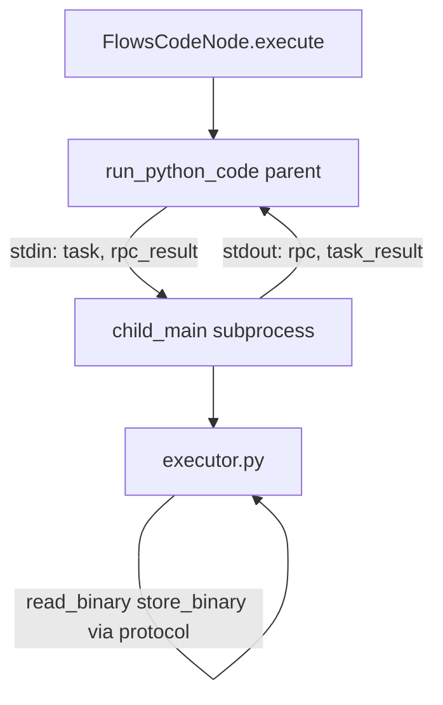

# `flows.code` — Python Code Node Plan

Plan to extend DocRouter’s **Code (Python)** node (`flows.code`) with n8n-inspired execution, security, and I/O behavior, using **`def run(items, context)` as the only authoring model**.

**Reference (behavior only — do not copy naming):** n8n `packages/@n8n/task-runner-python/` (`task_executor.py`, `task_analyzer.py`, `import_validation.py`, `task_runner.py`) and `packages/nodes-base/nodes/Code/` (`Code.node.ts`, `PythonTaskRunnerSandbox.ts`, `result-validation.ts`).

**Out of scope for this document:** prior `flows_code_node_v2_plan.md` / `flows_code_node_v3_plan.md` drafts.

---

## 1. Goals

1. **Execution modes** — support “run once for all items” and “run once for each item”, matching n8n scheduling behavior.
2. **Item-shaped I/O** — read and write full items (`json`, `binary`, `paired_item`, `meta`), not JSON-only passthrough.
3. **`def run()` authoring only** — user code must define `def run(items, context) -> list[dict]`; no script-style `return` or `_items` / `_item` globals.
4. **Security hardening** — AST static analysis, import allowlists, denied builtins, environment isolation.
5. **Operational parity** — rich `print()` output, structured errors, timeout/cancel, `on_error: continue` integration.
6. **DocRouter extensions** — retain execution `context`, upstream `nodes` materialization, and `BinaryRef` by `storage_id` (not raw bytes in the sandbox).

### Non-goals

- n8n script-style authoring (`return` at top level, `_items` / `_item` / `_query` globals).
- JavaScript code node (separate node type if ever needed).
- Pyodide / in-browser Python.
- Arbitrary network or filesystem access from user code.
- PDF byte manipulation in the code sandbox (split/merge/reorder) — use dedicated flow nodes
  (e.g. existing `docrouter.document_split`; planned merge node for combining PDFs on an item).
- A mandatory long-lived task-runner process in v1 (subprocess-per-invocation is acceptable initially; persistent runner is a later optimization).

---

## 2. Current state (DocRouter)

| Area | Today |
|------|--------|
| Node key | `flows.code` (`FlowsCodeNode`) |
| Authoring contract | Must define `def run(items: list[dict], context: dict) -> list[dict]` |
| Execution shape | Always batched: engine calls `execute()` once with all upstream items (`batch_execute_inputs`) |
| Subprocess | Fresh `python -I -S -c <runner>` per invocation (`code_runner.py`) |
| Imports | None (`__import__` removed from builtins) |
| Builtins | Small allowlist (~20 functions) + `print`/`log` shims |
| Input items | `item.json` only — binaries not visible to user code |
| Output items | User returns JSON dicts; node copies `binary` from input by index |
| `paired_item` | Not set by code node |
| Context | `trigger`, `nodes` (upstream JSON today; plan adds binary metadata refs), execution metadata |
| Logging | `print`/`log` → `context.node_logs` → run_data `logs` |
| Timeout | Per-node `timeout_seconds` (default 2, max 30) |
| Errors | Node failure; engine `on_error: continue` wraps outer exception |
| Security | Process boundary + no imports; no AST pre-check |

Relevant files:

- `packages/python/analytiq_data/flows/nodes/code.py`
- `packages/python/analytiq_data/flows/code_runner.py`
- `packages/python/analytiq_data/flows/items.py` (`FlowItem`, `BinaryRef`)
- `packages/typescript/frontend/src/components/flows/FlowCodeEditorField.tsx`

---

## 3. n8n Python code node — what we adopt

n8n’s Python runner uses script-style code (`return` at top level, `_items` / `_item` globals). **We do not port that authoring model.** We adopt the behaviors below and implement them through `def run(items, context)`.

### 3.1 Execution modes (scheduling parity)

| Mode (UI) | Runner `mode` | `run()` invocation | Where |
|-----------|---------------|-------------------|--------|
| Run once for all items | `all_items` | `run(items, context)` once with the full input list | Child `executor.py` |
| Run once for each item | `per_item` | `run([item], context)` once per input item | Child `executor.py` loops |

**Subprocess model:** one child subprocess per **node `execute()`** call — not one subprocess per
input item. The parent spawns once with stdin/stdout `PIPE`, sends a framed `task` message on
stdin, and reads framed `rpc` / `task_result` messages on stdout (§5.7). For `per_item` mode, the
child’s `executor.py` loops over items; the parent runs one protocol loop for the whole invocation.

User code always defines:

```python
def run(items: list[dict], context: dict) -> list[dict]:
    ...
```

### 3.2 Return value normalization

**All-items mode** — `run()` must return a `list`. Each element:

- Plain dict → wrapped as `{"json": dict}`.
- Item-shaped dict with `json` / `binary` keys → used as-is.
- If any element uses reserved top-level keys (`json`, `binary`, `paired_item`, `meta`), all keys on that element must be reserved (no stray top-level fields). Executor-synthesized `json._error` items are not user returns.

**Per-item mode** — each `run([item], context)` call must return a `list`:

- `[]` → filter out (drop) the input item.
- `[plain_dict]` → one output item; `paired_item` set to source index unless explicit.
- `[{json, binary?, paired_item?}]` → explicit item shape.

### 3.3 `print()` debugging

- Custom `print` captures arguments, JSON-serializes them, formats for UI console.
- Non-serializable args become `"[Circular <Type>]"` placeholders.
- Truncated to 100 print calls per execution.
- n8n streams prints to the browser via RPC during execution; we already buffer into `node_logs` and can enhance formatting to match.

### 3.4 Security model

**Pre-execution AST analysis** (`TaskAnalyzer` / `SecurityValidator`):

- Reject `import` / `from ... import` for modules outside allowlists.
- Reject relative imports.
- Block dangerous names (`__builtins__`, `__loader__`, `__globals__`, …).
- Block dangerous attribute access (`__class__`, `__globals__`, `__subclasses__`, traceback frames, …).
- Block dynamic `__import__(non_literal)`.
- Block `__builtins__['...']` subscript access to blocked keys.
- Block format-string patterns that reference blocked names/attributes.
- Block `match` patterns that extract blocked attributes.
- Validation result cached (SHA-256 of code + allowlists, FIFO cap 500).

**Runtime restrictions** (`TaskExecutor`):

- `__builtins__` filtered: names in `BUILTINS_DENY_DEFAULT` removed (§5.6); overridable via `FLOW_CODE_BUILTINS_DENY`.
- Safe `__import__` wrapper enforces same allowlists as AST.
- `os.environ` cleared when env blocking enabled (default) — early in child startup, before user code.
- **`sys.modules` sanitization** — remove disallowed entries from `sys.modules` so user code cannot
  import already-loaded modules that bypass the allowlist. **Ordering is critical:** sanitize at the
  **last step before `exec(user_code)`**, after all runner infrastructure is initialized (protocol
  I/O, `json`, `traceback`, `importlib`, AST already run on parent, builtins filter, safe
  `__import__`, custom `print`, execution globals). Sanitizing earlier would break the child’s own
  imports or leave runner-only modules visible to user `import` until the next sanitize pass.

**Import allowlists** (env-configured, default empty = no imports):

- `N8N_RUNNERS_STDLIB_ALLOW` — comma-separated stdlib top-level modules, or `*` alone.
- `N8N_RUNNERS_EXTERNAL_ALLOW` — comma-separated PyPI packages, or `*` alone.
- Wildcard `*` cannot be combined with other entries.

### 3.5 Lifecycle & errors

- Task timeout (default 60s in n8n; we keep per-node override with a higher ceiling).
- Cancellation → SIGTERM, then SIGKILL after grace period.
- `continue_on_fail` → on error, executor synthesizes `[{"json": {"_error": {"message": "..."}}}]` instead of failing (§5.8).
- Errors include `message`, `description`, `stack`, captured `stderr`.
- Syntax / security violations fail before subprocess spawn.

### 3.6 Architecture (n8n)

- Long-lived **Python Task Runner** process connects to a task broker over WebSocket.
- Broker assigns tasks with code + items; runner spawns **forkserver** child per task.
- Concurrency limit, payload size limit, health check server, auto-shutdown on idle.

DocRouter does not need the broker/WebSocket stack for parity, but should adopt the **executor + analyzer** logic inside our subprocess runner (or an optional sidecar later).

---

## 4. Gap analysis

| Feature | n8n | DocRouter today | Planned |
|---------|-----|-----------------|---------|
| All-items mode | ✓ | ✓ (only mode) | Keep + refine I/O |
| Per-item mode | ✓ | ✗ | Add via repeated `run([item], …)` |
| Script `return` style | ✓ | ✗ | **Not planned** |
| `def run(items, context)` | ✗ | ✓ | **Only authoring model** |
| `_items` / `_item` globals | ✓ | ✗ | **Not planned** — use `items` arg |
| Item `binary` in/out | ✓ | Partial (blind copy) | Full |
| `paired_item` on output | ✓ (per-item auto) | ✗ | Add |
| Per-item filter (`return []`) | ✓ (`return None`) | ✗ | Add (`run` returns `[]`) |
| Import allowlists | ✓ | ✗ | Add |
| AST security validator | ✓ | ✗ | Add |
| Denied builtins | ✓ | Partial (implicit via tiny builtins) | Add explicit list |
| Env blocking | ✓ | Partial (`-I` ignores PYTHON*) | Add `os.environ.clear()` |
| Rich `print()` formatting | ✓ | Basic string lines | Upgrade |
| `continue_on_fail` | ✓ | Engine-level only | In-runner + engine |
| Cancellation | ✓ | `stop_requested` at engine | Propagate to subprocess |
| Persistent runner | ✓ | ✗ | Optional phase 2 |
| Execution `context` dict | ✗ | ✓ | Keep (extension) |
| `BinaryRef.storage_id` | N/A | ✓ | Keep (extension) |

---

## 5. Target design

### 5.1 Node parameters (manifest + UI)

Add to `parameter_schema`:

```json
{
  "mode": {
    "type": "string",
    "enum": ["all_items", "per_item"],
    "default": "all_items",
    "description": "Run once for all input items, or once per item.",
    "x-ui-widget": "select",
    "x-ui-group": "Options"
  },
  "python_code": {
    "type": "string",
    "minLength": 1,
    "default": "def run(items, context):\n  return items\n",
    "description": "Must define def run(items: list[dict], context: dict) -> list[dict].",
    "x-ui-widget": "code",
    "x-ui-group": "Code"
  },
  "timeout_seconds": { "...": "keep; raise max to 120 for parity with runner defaults" }
}
```

UI (node config panel):

- **Mode** dropdown: “Run once for all items” / “Run once for each item”.
- Code editor default template switches by mode (see §5.3).
- Notice: must define `def run(items, context)`; debug with `print()`; output appears in execution logs.
- Link to internal docs for `context` and binary refs.

`batch_execute_inputs` is `true` for both modes: the engine calls `FlowsCodeNode.execute()` once
with all upstream items. That triggers **one** subprocess spawn. Mode only changes what happens
inside the child:

- `all_items` — `executor.py` calls `run(all_items, context)` once.
- `per_item` — `executor.py` loops over `all_items`, calling `run([item], context)` per element and
  concatenating results.

The parent never loops over items for per-item mode and never spawns N subprocesses for N items.

### 5.2 Serializable item contract (subprocess boundary)

Pass items as JSON-safe dicts:

```python
{
  "json": { ... },
  "binary": {
    "<field_name>": {
      "mime_type": "application/pdf",
      "file_name": "doc.pdf",
      "storage_id": "flow_blobs:exec/c1/0/data",
      "file_size": 12345
    }
  },
  "meta": { ... },
  "paired_item": 0
}
```

**`paired_item` semantics** — provenance link from an **output item** back to **input item index(es)**
on the node’s primary input slot (`main[0]`). Indices are 0-based positions in the `items` list
passed to `run()` (all-items) or the full upstream batch (per-item). `null` means unset; the engine
may infer a default (see §5.4).

| Value | Meaning | Typical use |
|-------|---------|-------------|
| `int` | This output came from **one** input item at that index | Default for per-item mode; 1:1 transform |
| `list[int]` | This output was derived from **multiple** input items | Aggregate in `all_items` mode — e.g. one output row grouping pages `2,3,4` for a downstream merge node → `paired_item: [2, 3, 4]` |
| `null` / omitted | No explicit provenance | Parent infers when possible |

DocRouter uses a flat `int | list[int]` (not n8n’s `{item, input}` object). Multi-input-slot
provenance (`input_slot` > 0) is carried in `meta`, not in `paired_item`.

**Code node defaults:**

- **Per-item mode:** if omitted, child sets `paired_item` to the current source index (`int`).
- **All-items mode:** no automatic inference — user should set `paired_item` when fan-in/fan-out
  matters for lineage or downstream debugging. Returning `N` outputs from `M` inputs without explicit
  `paired_item` leaves provenance unset unless the parent stamps `meta.item_index` only.

**UI / expressions today:** lineage display handles `int`; for `list[int]` it shows the first index
(`from Node · item 2`). Full multi-parent expression traversal (n8n `pairedItem()` ancestry) is not
required for v1 but the field is stored for forward compatibility.

Rules:

- Never embed `binary.data` bytes in the subprocess payload (input or output).
- **Input:** binary fields are metadata only (`mime_type`, `file_name`, `storage_id`, `file_size`).
- **Output:** each entry under `binary` must include a valid `storage_id`. New blobs must be persisted inside `run()` via `store_binary()` (§5.7) before returning.
- **Reject (default):** if any returned binary entry lacks `storage_id`, validation fails with a clear error naming the field and item index, e.g. `binary['pdf'] has no storage_id; call store_binary() to persist new blobs before returning.` There is no passthrough or field-name fallback from input items.

### 5.3 Authoring contract (`def run` only)

User code must define a callable `run`. The runner `exec`s the snippet into a **single namespace**,
resolves `run`, and invokes it. No script wrapper, no `_items` / `_item` injection.

#### `exec` namespace (single dict — required)

In CPython, `exec(code, globals_dict, locals_dict)` stores `def` bindings in `locals_dict` when
`globals_dict` and `locals_dict` are **different** objects. A helper defined in the same snippet is
then invisible to `run()` (which looks up names in `globals_dict`) → `NameError` at call time unless
the user adds `global` declarations.

**Required pattern:**

```python
ns: dict[str, Any] = {
    "__builtins__": filtered_builtins,
    "items": items,           # set per mode before call
    "context": context,
    "read_binary": ...,
    "store_binary": ...,
    "print": custom_print,
}
sanitize_sys_modules(...)
exec(user_code, ns)          # same dict for globals and locals
run = ns["run"]
if not callable(run):
    raise ...
```

Do **not** use `exec(code, g, l)` with separate `g` and `l`. Multi-function snippets are first-class:

```python
def _helper(row):
    return row.get("value", 0) * 2

def run(items, context):
    return [{"doubled": _helper(item["json"])} for item in items]
```

**All-items example:**

```python
def run(items, context):
    out = []
    for item in items:
        row = dict(item["json"])
        row["doubled"] = row.get("value", 0) * 2
        out.append(row)
    return out
```

**Per-item example** (runner calls `run([item], context)` per input item):

```python
def run(items, context):
    item = items[0]
    value = item["json"].get("value", 0)
    if value < 10:
        return []  # filter out
    return [{"doubled": value * 2}]
```

**`context` argument** (second parameter):

```python
context = {
  "trigger": ...,
  "nodes": {
    "<node_id>": {
      "status": "success",
      "main": [
        [
          {
            "json": { ... },
            "binary": {
              "<field>": {
                "mime_type": "application/pdf",
                "file_name": "doc.pdf",
                "storage_id": "flow_blobs:exec/up/0/pdf",
                "file_size": 12345,
              }
            },
            "meta": { ... },
            "paired_item": 0,
          },
          ...
        ],
      ],
      "start_time": "...",
      "execution_time_ms": 123,
    }
  },
  "node_id", "mode", "organization_id", "execution_id",
  "flow_id", "flow_revid", "start_time", "execution_time",
}
```

**`context["nodes"]` binary visibility:** upstream node outputs use the same §5.2 item shape as direct `items` input. Each item includes `json` and, when present, `binary` refs — **metadata only** (`mime_type`, `file_name`, `storage_id`, `file_size`). Never embed `binary.data` bytes. Use `read_binary(storage_id)` (§5.7) when user code needs blob contents.

Extend `materialize_node_data()` (today JSON-only per slot item) to emit full item-shaped dicts with binary metadata refs.

Direct `items` input uses the same §5.2 shape (`json`, `binary`, `meta`, `paired_item`).

### 5.4 Output mapping → `FlowItem`

After subprocess returns normalized item dicts:

```python
FlowItem(
  json=item["json"],
  binary={k: coerce_binary_ref(v) for k, v in (item.get("binary") or {}).items()},
  meta={**preserved_meta, "source_node_id": node_id, "item_index": idx},
  paired_item=item.get("paired_item") if item.get("paired_item") is not None else infer_from_mode,
)
```

**`paired_item` inference (parent, after subprocess):**

| Mode | User omits `paired_item` | User sets `paired_item` |
|------|--------------------------|-------------------------|
| `per_item` | Set to source input index (`int`) for each output from that `run([item], …)` call | Use as-is (`int` or `list[int]`) |
| `all_items` | Leave `None` (only `meta.item_index` on output position) | Use as-is — required for aggregate outputs |

Fan-out in per-item mode (one input → multiple outputs) may give the same `int` on several outputs
or distinct indices per output row; user may override explicitly.

### 5.5 Result validation

Implement `validate_code_output()` in `code_runner/validation.py`. Rules below adapt n8n
`result-validation.ts` for DocRouter: `def run()` return values, snake_case reserved keys, and
§5.2 binary `storage_id` requirements.

#### Reserved top-level keys

An output **item** (one element of `run()`’s return list) may use these top-level keys only:

| Key | Type | Notes |
|-----|------|--------|
| `json` | `dict` | Payload fields live here |
| `binary` | `dict[str, dict]` | Values are binary metadata refs (§5.2); each must have `storage_id` |
| `meta` | `dict` | Optional engine/user metadata |
| `paired_item` | `int` \| `list[int]` \| `null` | Input provenance (§5.2); per-item auto-fill when omitted |

No other top-level keys are allowed on an **explicit** item shape (see mixed-key rule below).

**No top-level `error` key.** `FlowItem` has `json`, `binary`, `meta`, and `paired_item` only. n8n’s
`INodeExecutionData.error` is not modeled at the top level in DocRouter. Failure metadata lives
**inside `json`** (see continue-on-fail shape below).

#### Normalization (`normalize_output_items`)

Applied to each element of `run()`’s return list **before** field validation:

1. **Plain dict** — no reserved top-level key present → wrap: `{"json": <dict>}`.
2. **Explicit item shape** — at least one reserved key present → use as-is, then enforce rules below.
3. **Missing `json` on explicit shape** — default to `{"json": {}}` (allows binary-only items).
4. **Non-dict element** — reject with item index.

#### Top-level key rules (`validate_top_level_keys`)

For each normalized item at `item_index`:

1. Collect top-level keys. Split into **reserved** (table above) vs **unknown**.
2. **Mixed keys (reject):** if the item has ≥1 reserved key **and** ≥1 unknown key → reject with
   `ReservedKeyError`, e.g. `Output item at index 2 mixes reserved key 'json' with 'patient_id'.
   Put custom fields under json, e.g. return {"json": {"patient_id": ...}}.`
3. **Unknown keys only (reject):** if the item has unknown keys and **no** reserved keys, normalization
   should have wrapped it; if it still reaches here, reject: `Unknown top-level key 'foo' at index 2.
   Put fields under json.`
4. **All-items batch rule:** if **any** item in the return list has a reserved top-level key,
   run `validate_top_level_keys` on **every** item **before** normalization. Items with only
   non-reserved keys then fail (unknown top-level key) — user must either return all plain dicts
   (none use reserved keys) or use explicit `{"json": ...}` on every item in that return.

#### Field rules (`validate_item_fields`)

For each normalized item at `item_index`:

| Field | Rule | Error (summary) |
|-------|------|-----------------|
| `json` | Required; must be `dict` | `'json' must be a dict at index N` |
| `binary` | If present, must be `dict`; each value must be `dict` with non-empty `storage_id` | See §5.2 |
| `meta` | If present, must be `dict` | `'meta' must be a dict at index N` |
| `paired_item` | If present, must be `int`, `list[int]` (non-empty ints), or `null` | Invalid `paired_item` at index N |

Binary ref sub-fields allowed on input/output metadata: `mime_type`, `file_name`, `storage_id`,
`file_size`. Reject `data` (raw bytes) on output.

#### Continue-on-fail item shape (executor-synthesized)

When `on_error: "continue"` and the child catches an execution exception, the **executor** emits
error items — not user `run()` code. These bypass user return validation and use a fixed shape
aligned with `engine._error_item()`:

```python
{
  "json": {
    "_error": {
      "message": "<exception string>",
      "node_id": "<from context>",      # parent may enrich on map
      "node_name": "<from context>",
    }
  },
  "paired_item": <source index>,        # per-item mode only
}
```

Use **`json["_error"]`**, not top-level `error` and not `json["error"]`. Rationale:

| Option | Verdict |
|--------|---------|
| Top-level `error` | No home on `FlowItem`; n8n Python runner does not use it for continue-on-fail |
| `json["error"]` (string) | n8n Python runner shape, but conflicts with user payloads that legitimately have an `error` field |
| `json["_error"]` (object) | Matches existing DocRouter `engine._error_item()`; distinguishable from user data; one convention for all `on_error: continue` paths |

User-authored returns must not include `_error` unless intentionally signaling failure (discouraged;
prefer raising and letting the executor synthesize the envelope).

#### Mode-specific rules

**All-items** (`run(items, context)` called once):

| Condition | Result |
|-----------|--------|
| `run()` return is not a `list` | Reject: `run() must return a list` |
| Return is `[]` | Valid (zero output items) |
| Each element fails normalization/validation | Reject with `item_index` |

**Per-item** (`run([item], context)` called per input):

| Condition | Result |
|-----------|--------|
| `run()` return is not a `list` | Reject for that input index |
| Return is `[]` | Valid — input item filtered out |
| Return has >1 element | Valid — one input may fan out to multiple outputs |
| Each output element | Same normalization + validation as all-items |
| `paired_item` omitted | Parent sets to source input index (`int`) |

#### Error shape

Validation failures raise `CodeValidationError` with:

- `message` — short summary
- `description` — remediation hint (wrap under `json`, call `store_binary()`, etc.)
- `item_index` — `int` when applicable; omit for whole-return failures

Parent maps these to `CodeExecutionError` / node error envelope for the UI.

#### Examples

```python
# OK — all plain dicts (no reserved keys in batch) → each wrapped
return [{"patient_id": "p1"}, {"patient_id": "p2"}]
# → [{"json": {"patient_id": "p1"}}, {"json": {"patient_id": "p2"}}]

# OK — explicit shape
return [{"json": {"patient_id": "p1"}, "binary": {"pdf": {"storage_id": "flow_blobs:...", "mime_type": "application/pdf"}}}]

# OK — all_items aggregate: one output from multiple inputs (pages 2–4)
return [{"json": {"patient_id": "p1"}, "paired_item": [2, 3, 4]}]

# REJECT — mixed top-level keys on one item
return [{"json": {"a": 1}, "patient_id": "p1"}]

# REJECT — batch mixes explicit + plain dict
return [{"json": {"a": 1}}, {"patient_id": "p1"}]
# second item: unknown top-level key 'patient_id' (batch already has explicit shape)

# REJECT — binary without storage_id
return [{"json": {}, "binary": {"pdf": {"mime_type": "application/pdf"}}}]
```

### 5.6 Security configuration (DocRouter env vars)

Mirror n8n semantics with DocRouter-prefixed names:

| Env var | Default | Purpose |
|---------|---------|---------|
| `FLOW_CODE_STDLIB_ALLOW` | `json,re,math,datetime,collections,itertools,functools,hashlib,base64,uuid,typing` | Allowed stdlib modules, or `*` |
| `FLOW_CODE_EXTERNAL_ALLOW` | `""` (none) | Allowed third-party top-level modules, or `*` |
| `FLOW_CODE_BUILTINS_DENY` | `BUILTINS_DENY_DEFAULT` (§ below) | Comma-separated builtin names removed from `__builtins__` |
| `FLOW_CODE_BLOCK_ENV_ACCESS` | `true` | Clear `os.environ` in child |
| `FLOW_CODE_ENABLED` | `true` | Kill-switch (like `N8N_PYTHON_ENABLED`) |
| `FLOW_CODE_MAX_PAYLOAD_BYTES` | `33554432` (32 MiB) | Max stdin/stdout JSON size |

Document in `docs/env.md`.

Default stdlib allowlist (when `FLOW_CODE_STDLIB_ALLOW` is unset):

`json`, `re`, `math`, `datetime`, `collections`, `itertools`, `functools`, `hashlib`, `base64`, `uuid`, `typing`

Default external allowlist (when `FLOW_CODE_EXTERNAL_ALLOW` is unset): **none**.

Third-party packages (e.g. `fitz`, `pandas`, `pydantic`) are disallowed unless added to
`FLOW_CODE_EXTERNAL_ALLOW`.

**`BUILTINS_DENY_DEFAULT`** — defined in `code_runner/security.py` (ported from n8n
`task-runner-python` `constants.py`). Used when `FLOW_CODE_BUILTINS_DENY` is unset. These names
are removed from the sandbox `__builtins__` dict:

`eval`, `exec`, `compile`, `open`, `input`, `breakpoint`, `getattr`, `object`, `type`, `vars`,
`setattr`, `delattr`, `hasattr`, `dir`, `memoryview`, `__build_class__`, `globals`, `locals`,
`license`, `help`, `credits`, `copyright`

Env value is a comma-separated list; same names, no spaces required. Wildcard is not supported.

### 5.7 Parent-side helper RPCs (DocRouter extension)

n8n’s JS runner exposes many RPC helpers; Python runner only RPCs print to browser. For DocRouter
binary workflows, add **parent-process helpers** callable from user code during execution.

| Helper | Purpose |
|--------|---------|
| `read_binary(storage_id) -> base64` | Load blob for in-sandbox processing (size-capped) |
| `store_binary(mime_type, file_name, base64) -> storage_id` | Persist new blob |

Helpers are allowlisted, audited, and rate/size limited. Not part of n8n Python parity but required
for document workflows (pass-through and new blobs via `storage_id`). PDF split/merge stays in
dedicated nodes (`docrouter.document_split` today; merge node planned separately).

#### I/O channels — multiplexed stdin/stdout (no extra pipes)

The child has **one stdin and one stdout**. Use them for **both** the task lifecycle and helper RPC
via a **length-prefixed JSON stream** (4-byte big-endian length + UTF-8 JSON). Every message
includes a `"type"` discriminator. No second pipe pair, no `pass_fds`, no extra fd ownership.

| Channel | Direction | Content |
|---------|-----------|---------|
| stdin | parent → child | `task` message, then `rpc_result` messages |
| stdout | child → parent | `rpc` messages during execution, then one `task_result` |

**Why reuse stdin/stdout (not separate RPC pipes):**

- Extra pipes require `pass_fds`, asyncio `connect_*_pipe`, and careful per-fd ownership — easy to
  get wrong across threads.
- Stdin/stdout are already wired by `create_subprocess_exec(stdin=PIPE, stdout=PIPE)`.
- A stream protocol is sufficient: the task is not “one blob on stdout at EOF” — it is the **last**
  framed message of type `task_result`; `rpc` messages precede it on the same stream.

**Message types** (`protocol.py`):

```python
# parent → child (stdin), first message
{"type": "task", "code": "...", "mode": "all_items", "items": [...], "context": {...}, ...}

# child → parent (stdout), during run()
{"type": "rpc", "id": "1", "method": "read_binary", "args": ["flow_blobs:..."]}

# parent → child (stdin), reply
{"type": "rpc_result", "id": "1", "ok": true, "result": "<base64>"}
# or {"type": "rpc_result", "id": "1", "ok": false, "error": {"message": "..."}}

# child → parent (stdout), when finished
{"type": "task_result", "ok": true, "items": [...], "logs": [...]}
```

**Child stdout is protocol-only.** `print()` / `log()` must use the custom shim (buffered into
`logs` on `task_result`) — never write debug text to `sys.stdout`, or framing breaks.

**Parent protocol loop** (single asyncio coroutine, single event loop):

1. Write `task` message on stdin (keep stdin open).
2. Loop read framed messages from stdout:
   - `type == "rpc"` → run helper in parent (`read_binary` / `store_binary`), write `rpc_result` on
     stdin.
   - `type == "task_result"` → return parsed payload; close stdin.
3. No `communicate()`, no `to_thread`, no second coroutine on stdout.

**Child:** single-threaded; `read_binary` / `store_binary` write `rpc` on stdout, block read
`rpc_result` from stdin. Same fds as task setup — serialized by synchronous user code.

**Rejected alternatives:**

| Approach | Why not |
|----------|---------|
| Extra pipe pair | `pass_fds`, fd ownership complexity, thread hazards |
| Unix socket | Unnecessary for parent/child subprocess; consider for Phase 2 sidecar only |
| Raw JSON blob on stdout at EOF | Cannot interleave helper RPC mid-execution |

### 5.8 `on_error: continue` integration

Two layers:

1. **In-runner `continue_on_fail`** — when the node has `on_error: "continue"`, pass flag to the
   child. On execution exception, the **executor synthesizes** error items (§5.5 continue-on-fail
   shape) instead of propagating the exception:
   - **All-items:** `[{"json": {"_error": {"message": "...", "node_id": "...", "node_name": "..."}}}]`
   - **Per-item:** same `json._error` shape + `paired_item` set to the source input index; other
     items from successful iterations are still emitted.
2. **Engine** — if the runner/subprocess fails outright (timeout, validation error, crash), the
   existing `engine._error_item()` path applies with the same `json._error` envelope.

Do not use `json["error"]` (n8n Python runner string) or top-level `error`; standardize on
`json._error` for all continue paths in DocRouter.

---

## 6. Runtime architecture

### Phase 1 — Enhanced subprocess runner (recommended first ship)

**Invariant:** one subprocess spawn per node invocation; per-item looping happens only in the child.

Replace monolithic `_RUNNER_CODE` string with a proper package:

```
packages/python/analytiq_data/flows/code_runner/
  __init__.py          # run_python_code() public API
  analyzer.py          # AST SecurityValidator (from n8n task_analyzer)
  import_validation.py
  executor.py          # exec user code once; all_items vs per_item run() dispatch/loop
  builtins.py          # filtered __builtins__, safe __import__
  protocol.py          # framed messages on stdin/stdout (task, rpc, rpc_result, task_result)
  rpc.py               # helper client (child) / dispatch (parent); uses protocol.py
  child_main.py        # entry for `python -m analytiq_data.flows.code_runner.child_main`
```

**I/O at spawn:** stdin + stdout only (`PIPE`). No extra fds.

**Parent** (`run_python_code` / `FlowsCodeNode.execute`):

1. Run AST validation on parent side (fail fast).
2. Spawn **one** `python -I -S -m analytiq_data.flows.code_runner.child_main` with `stdin=PIPE`,
   `stdout=PIPE`.
3. Run `run_protocol_loop(proc)` on the asyncio event loop:
   - Write framed `task` message on stdin.
   - Read framed messages from stdout until `task_result`; on each `rpc`, dispatch helper and write
     `rpc_result` on stdin.
   - Close stdin after `task_result`.
4. Enforce timeout; on cancel/`stop_requested`, kill child (SIGTERM → SIGKILL).
5. Map `task_result` to `FlowItem` list in `FlowsCodeNode.execute`.

Do **not** use `communicate()`, `to_thread`, or extra pipe pairs.

**Child** (`child_main` → `executor.py`):

1. Read framed `task` message from stdin.
2. Apply early sandbox setup: clear `os.environ` if blocked; install filtered `__builtins__`, safe
   `__import__`, custom `print` (not to stdout).
3. Build execution globals (`items`, `context`, `read_binary` / `store_binary` → `rpc.py` client on
   stdin/stdout).
4. **`sanitize_sys_modules()`** — last step before user code (§3.4).
5. `exec(user_code, ns)` with **one** namespace dict for both globals and locals; `run = ns["run"]`
   (§5.3). Reject if missing or not callable.
6. If `mode == "all_items"`: `result = run(items, context)`.
7. If `mode == "per_item"`: loop `run([item], context)` per input item.
8. Write framed `task_result` on stdout.

Do **not** spawn a subprocess per input item. Do **not** have the parent call `run_python_code`
in a loop over items for per-item mode.

Keep subprocess-per-node-invocation for isolation; per-item mode pays one spawn cost regardless of
item count.

### Phase 2 — Optional persistent runner (performance)

If profiling shows subprocess spawn dominates:

- Sidecar process modeled on n8n `task_runner.py` (without copying broker naming).
- Worker communicates via Unix socket / pipe with same JSON task schema.
- Reuse `TaskExecutor` logic from phase 1 inside the sidecar.
- Deploy alongside worker in `docker-compose.yml`; gated by `FLOW_CODE_RUNNER_MODE=subprocess|sidecar`.

Not required for feature parity.



---

## 7. Module-by-module port map (n8n → DocRouter)

| n8n module | DocRouter target | Notes |
|------------|------------------|-------|
| `task_analyzer.py` | `code_runner/analyzer.py` | Port `SecurityValidator`, cache |
| `import_validation.py` | `code_runner/import_validation.py` | Direct port |
| `task_executor.py` | `code_runner/executor.py` | Per-item loop in child; one subprocess per node invoke |
| `constants.py` (security) | `code_runner/security.py` | `BLOCKED_NAMES`, `BLOCKED_ATTRIBUTES`, `BUILTINS_DENY_DEFAULT` |
| `config/security_config.py` | `code_runner/config.py` | Read `FLOW_CODE_*` env |
| `task_runner.py` | optional sidecar | Phase 2 only |
| `result-validation.ts` | `code_runner/validation.py` | Port validation rules |
| `PythonTaskRunnerSandbox.ts` | `nodes/code.py` | Task assembly, mode mapping |
| `PythonCodeDescription.ts` | manifest + `flowNodeConfigFields.tsx` | Mode UI, templates, notices |

---

## 8. UI & DX

### 8.1 Code editor templates

| Mode | Default template |
|------|------------------|
| all_items | `def run(items, context):` loop over `items`, return list |
| per_item | `def run(items, context):` read `items[0]`, return `[]` or `[{...}]` |

### 8.2 Execution logs panel

- Show `print_args` with structured formatting (strings quoted, JSON pretty-printed).
- Prefix `[user code]` like n8n console.
- Truncation notice when >100 prints.

### 8.3 Pin data & step execute

- Ensure pinned items serialize with binary refs for code node debugging.
- Step execute already supported; verify per-item mode shows correct `paired_item` in IO viewer.

### 8.4 Docs snippet for users

- Must define `def run(items, context) -> list[dict]`.
- In per-item mode, `items` is always a one-element list; return `[]` to drop the item.
- Explain `context["nodes"]` for upstream items (`json` + binary metadata refs).
- Explain binary is by reference; use helpers to read/write bytes.
- List allowed imports from deployment config.
- Python does not support expression `{{ }}` inside code (parameters only).

---

## 9. Implementation phases

### Phase A — Modes + `def run` + validation

- [ ] Add `mode` parameter; manifest v2 (`type_version: 2`).
- [ ] `exec(user_code, ns)` single-namespace binding (§5.3); test snippet with helper `def` + `run`.
- [ ] Port result normalization/validation.
- [ ] Per-item filtering via `return []`.
- [ ] Set `paired_item` on per-item outputs.
- [ ] Tests adapted from n8n `test_execution.py` (success, filter, binary, explicit json) using `def run` snippets.

### Phase B — Item-shaped I/O

- [ ] Pass full serializable items into subprocess (json + binary refs + meta).
- [ ] Extend `materialize_node_data()` so `context["nodes"]` includes binary metadata refs (no bytes).
- [ ] Return binary metadata from user code; stop blind index-based binary copy.
- [ ] Parent maps output blobs to `BinaryRef`.
- [ ] E2E test: code groups pages and passes binaries to upload node.

### Phase C — Security

- [ ] Port `TaskAnalyzer` + `import_validation`.
- [ ] Filtered builtins + safe `__import__`.
- [ ] `sys.modules` sanitization in child — **after** runner infrastructure init, **immediately before** `exec(user_code)` (§3.4).
- [ ] Env blocking.
- [ ] `FLOW_CODE_*` env vars + `docs/env.md`.
- [ ] Security tests from n8n `test_execution.py` (globals/locals bypass, format strings, etc.).

### Phase D — Operations

- [ ] Rich `print()` formatting + truncation.
- [ ] Structured errors (`message`, `description`, `stack`, `stderr`).
- [ ] In-runner `continue_on_fail` wired to `on_error: continue`.
- [ ] Cancellation: propagate `stop_requested` to kill subprocess.
- [ ] Raise `timeout_seconds` max (e.g. 120s); align with worker execution limits.
- [ ] `FLOW_CODE_ENABLED` kill-switch with clear node error.

### Phase E — Helper RPCs (DocRouter extension)

- [ ] Multiplexed stdin/stdout protocol (`task` / `rpc` / `rpc_result` / `task_result`) in
  `protocol.py`; helper dispatch in `rpc.py`.
- [ ] `read_binary` / `store_binary` wired through protocol (not separate pipes).
- [ ] Size limits and audit logging.
- [ ] User-facing doc examples (read/transform/store binary flow).

### Phase F — Optional sidecar runner

- [ ] Persistent runner process + health check.
- [ ] Compose / deploy wiring.
- [ ] Benchmark vs subprocess baseline.

---

## 10. Testing strategy

| Layer | Tests |
|-------|-------|
| Unit | `analyzer`, `import_validation`, `validation`, `executor` (in-process with mocked I/O) |
| Integration | `run_python_code` subprocess: modes, security, timeout, logs |
| Engine | `test_flows_engine.py` extensions: per-item, binary, continue, paired_item |
| E2E | Existing `test_flows_e2e.py` patterns + surgery-schedule PDF scenario |
| Regression | All existing `def run` snippets unchanged (all-items mode) |

Adapt n8n integration test **behavior** (not script syntax) into `def run` equivalents:

- all-items transform loop
- per-item double / filter / binary passthrough
- `continue_on_fail` error items
- Security bypass attempts (builtins dict, format strings, env blocking)
- `print_*` formatting (logs panel equivalent)

---

## 11. Migration & compatibility

- **type_version 1** nodes: `mode=all_items` (implicit); existing `def run` code unchanged.
- **type_version 2** nodes: add `mode` parameter; default templates remain `def run(…)`.
- No automatic rewrite of user code in DB.
- No script-style or `_items` / `_item` templates — not supported.

---

## 12. Success criteria

- [ ] User authors code exclusively via `def run(items, context) -> list[dict]`.
- [ ] Per-item mode filters, pairs, and passes binary (empty list = drop item).
- [ ] Import allowlist + AST validator block the same bypass patterns covered in n8n’s suite.
- [ ] Existing `def run` all-items flows pass CI unchanged.
- [ ] Code node can read/write `BinaryRef` by `storage_id` (via helpers); PDF merge is not in scope for code.
- [ ] `print()` output is visible in execution UI with useful formatting.
