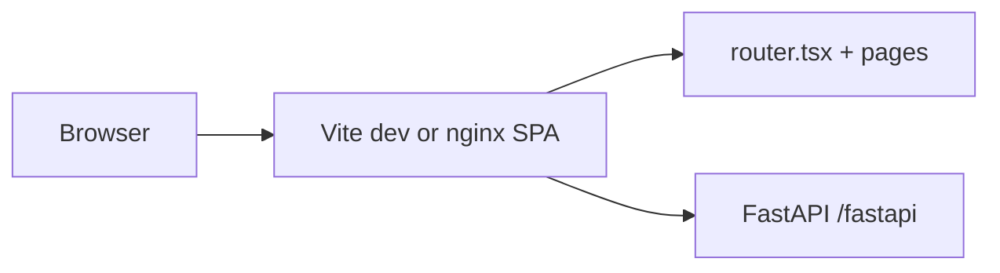

# Doc Router frontend: Vite SPA (migration complete)

**Status:** **Complete** — merged to `main`. Next.js and the App Router tree are gone; the only UI path is **Vite + React Router**.

**Active frontend work:** [**UI migration**](./design/ui-migration.md) (Tailwind 4 + shadcn/ui, aligned with doc-orchestrator).

**Route coverage:** [`vite_route_manifest.md`](./vite_route_manifest.md) · **Cutover record:** [`vite_next_elimination_plan.md`](./vite_next_elimination_plan.md) · **Dev smoke:** [`vite_smoke_test_5173.md`](./vite_smoke_test_5173.md)

---

## Current architecture

| Area | Implementation |
|------|----------------|
| **Entry** | `packages/typescript/frontend/index.html` → `src/main.tsx` |
| **Routing** | `src/router.tsx` + lazy routes; screens in `src/pages/**` |
| **Layouts** | `Layout`, `OrgLayout`, `SettingsAppLayout`, `RequireAuth`, … |
| **Navigation** | `@/utils/appRouter`, React Router `Link`, `AppImage`, `dynamicImport` |
| **Auth** | FastAPI httpOnly session cookie + OAuth; `GET /v0/account/auth/session` |
| **Public env** | `VITE_*` / `APP_*` via `publicEnv.ts` + `vite.config.ts` (`loadEnv` from repo `.env`) |
| **Dev** | `make dev` → FastAPI :8000 + Vite :5173; proxy `/fastapi` |
| **Production** | `npm run build` → `dist-vite/` → nginx (`deploy/shared/docker/Dockerfile` `runner`) |

---

## What was delivered (Phases A–E summary)

Operations (**A**), Docker/CI (**B**), removal of `next/*` shims (**C**), `src/pages/**` + lazy routes (**D**), and dropping the `next` package (**E**) are all done. Details and sign-off tables live in [`vite_next_elimination_plan.md`](./vite_next_elimination_plan.md) (historical reference).

---

## Operator notes (still relevant)

### OAuth on localhost:5173

For **social sign-in during `npm run dev`**, IdPs must allow callback URLs on port **5173** (in addition to compose/production hosts):

- Google: `http://localhost:5173/fastapi/v0/account/auth/google/callback`
- GitHub: `http://localhost:5173/fastapi/v0/account/auth/github/callback`

See [`vite_smoke_test_5173.md`](./vite_smoke_test_5173.md).

### Deep linking

Production and compose nginx use SPA fallback (`try_files` → `index.html`). See `packages/typescript/frontend/nginx-spa.conf`.

---

## Next: UI migration

Styling and primitives remain **Tailwind 3 + MUI + Headless UI** until the phased plan in [`design/ui-migration.md`](./design/ui-migration.md) lands. That doc is the **source of truth for frontend roadmap** after the Vite cutover.

---

*Last updated: Vite/Next migration complete on `main`.*
