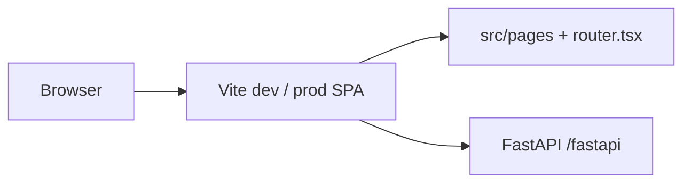

# Eliminating Next.js: where we are and cutover plan

Companion to [`vite_migration_plan.md`](./vite_migration_plan.md) and [`vite_route_manifest.md`](./vite_route_manifest.md).  
**Branch:** `vite`. **Phases A–E complete** — Next.js removed from `package.json`; UI is a Vite SPA only.

---

## Where we are (honest snapshot)

| Layer | Status | Notes |
|-------|--------|--------|
| **Product UI (browser)** | **Vite SPA** | `router.tsx` + lazy `src/pages/**`; rare org URLs → `OrgPlaceholderPage` 🔶 |
| **Auth / session** | **Backend-owned** | FastAPI cookie + OAuth; no Next API routes |
| **Local dev default** | **Vite only** | `make dev` → FastAPI + **Vite :5173** (`npm run dev`) |
| **CI** | **Vite** | `frontend-build.yml`: `typecheck` + **`npm run build`** |
| **Release images** | **Vite SPA only** | `release.yml` `target: runner` → `npm run build` + nginx (:80) |
| **Compose / K8s** | **Vite SPA only** | Frontend container nginx :80 |
| **Vite production path** | **`runner`** | `Dockerfile` stages `frontend` (vite build) → `runner` (nginx + `dist-vite/`) |
| **`next` npm package** | **Removed** | Phase E |
| **Source imports `next/*`** | **None** | React Router + `@/utils/appRouter`, `AppImage`, `dynamicImport` |
| **File layout** | **`src/pages/**`** | `src/app/` tree deleted; flow OAuth at `/oauth/flow-callback` in `src/pages/oauth/` |

### Mental model

---

## Phase A — complete (sign-off)

See historical table in git history; ops cutover closed earlier. Local/prod UI path is Vite-only.

---

## Phase B — CI and packaging only know Vite — **complete**

| # | Task | Status |
|---|------|--------|
| B1 | Dockerfile frontend stage runs **`npm run build`** (Vite) | ✅ |
| B2 | Removed **`runner-next`** Node standalone target | ✅ |
| B3 | **`doc-router-frontend`** image = nginx `runner` | ✅ |
| B4 | `make build-vite` + `frontend-build.yml` | ✅ |

---

## Phase C — Remove **shims** — **complete**

| # | Task | Status |
|---|------|--------|
| C1–C5 | React Router replacements for `next/*` client APIs | ✅ |
| C6 | Server redirects → `AuthLayoutGuard` | ✅ |

---

## Phase D — Restructure away from App Router **filesystem** — **complete**

| # | Task | Status |
|---|------|--------|
| D1 | Pages in `src/pages/**` | ✅ |
| D2–D6 | Client root, `publicEnv.ts`, lazy routes | ✅ |

---

## Phase E — Remove the **Next.js dependency** — **complete**

| # | Task | Status |
|---|------|--------|
| E1 | Remove `next`, `@types/next`, `eslint-config-next` | ✅ |
| E2 | Delete `next.config.mjs`, `src/app/`; scripts `dev`/`build`/`preview` = Vite | ✅ |
| E3 | ESLint flat config (`eslint.config.mjs`); `npm run lint` passes (warnings OK) | ✅ |
| E4 | Flow OAuth popup → `src/pages/oauth/flow-callback.tsx` + router entry | ✅ |
| E5 | **CLAUDE.md**, frontend **README**, Docker/CI/`start-all.sh` Vite-only | ✅ |
| E6 | `vite_migration_plan.md` Phase 6 checklist | ✅ |

**“Next eliminated”** = end of **Phase E** (current).

---

## Immediate next actions

1. **Merge `vite` → `main`** after review; cut a release so GHCR frontend image matches compose/Kind smoke.
2. **Staging/K8s smoke** once per environment (login, PDF, flows, flow OAuth popup).
3. **Follow-up (optional):** trim legacy `NEXT_PUBLIC_*` from `vite.config.ts` `define` once docs/env only document `VITE_*`; retarget stale paths in historical docs (`env.md`, `simple_license.md`).

---

## References

- Dev smoke: [`vite_smoke_test_5173.md`](./vite_smoke_test_5173.md)
- Route parity: [`vite_route_manifest.md`](./vite_route_manifest.md)
- Docker Vite target: `deploy/shared/docker/Dockerfile` (`frontend` → `runner`), `packages/typescript/frontend/nginx-spa.conf`
- Navigation: `packages/typescript/frontend/src/utils/appRouter.ts`, `dynamicImport.tsx`, `AppImage.tsx`

*Last updated: Phase E complete — no `next` dependency; `src/pages/` + Vite-only dev/build.*
