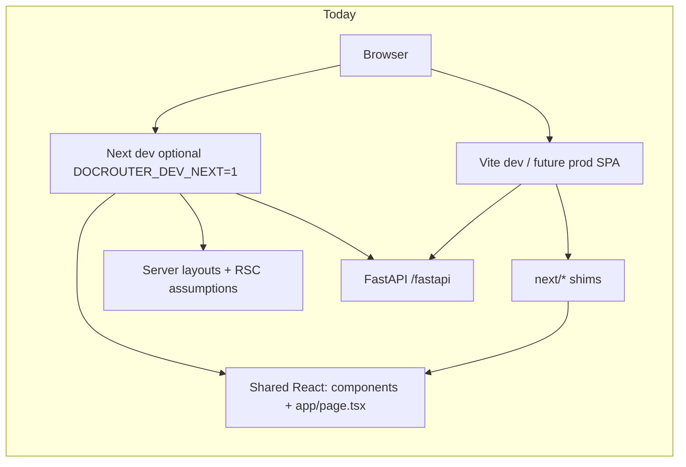

# Eliminating Next.js: where we are and cutover plan

Companion to [`vite_migration_plan.md`](./vite_migration_plan.md) and [`vite_route_manifest.md`](./vite_route_manifest.md).  
**Branch:** `vite`. **Phase A–B complete**; **Phase C in progress** (client code off `next/*` shims); **`next` still in `package.json`** for server layouts + optional `DOCROUTER_DEV_NEXT` until Phase E.

---

## Where we are (honest snapshot)

| Layer | Status | Notes |
|-------|--------|--------|
| **Product UI (browser)** | ~**95% routed on Vite** | `router.tsx` covers manifest ✅; rare org URLs → `OrgPlaceholderPage` 🔶 |
| **Auth / session** | **Backend-owned** | FastAPI cookie + OAuth; Next API routes for session/feedback **removed** |
| **Local dev default** | **Vite-first** | `make dev` → FastAPI + **Vite :5173**; Next :3000 only if **`DOCROUTER_DEV_NEXT=1`** |
| **CI** | **Hybrid** | `frontend-build.yml`: `typecheck` + **`build:vite`** (Next **`build`** not in CI) |
| **Release images** | **Vite SPA only** | `release.yml` `target: runner` → `build:vite` + nginx (:80) |
| **Compose / K8s** | **Vite SPA only** | Frontend container nginx :80; compose edge **localhost:3000** → edge nginx → frontend:80 |
| **Vite production path** | **`runner`** | `Dockerfile` stages `frontend` (vite build) → `runner` (nginx + `dist-vite/`) |
| **`next` npm package** | **Still installed** | Required for `npm run dev` / `npm run build` (Next) until removal |
| **Source imports `next/*`** | **Almost gone** | Vite client uses React Router; only `session.ts` (`next/headers`) for Next root `layout.tsx` SSR |
| **Next-only server code** | **Small but real** | `layout.tsx` files use `getAppServerSession` / `redirect` / `cookies()` from `next/headers`; **Vite does not run these layouts** (CSR + `RequireAuth` instead) |
| **File layout** | **Still App Router** | **55** `page.tsx` under `src/app/`; Vite **imports them as components**, not as Next routes |

### Mental model

**Vite does not bundle the Next framework** for production SPA builds; it bundles **shared React code** and **replaces** `next/*` imports via `vite.config.ts` aliases. The **`next` dependency** remains for optional local comparison and Phase B–E cleanup.

---

## Phase A — complete (sign-off)

| # | Task | Status |
|---|------|--------|
| A1 | Compose on Vite `runner` | ✅ login, dashboard, PDF ([smoke doc](./vite_smoke_test_5173.md#docker-compose-deploycompose-edge-3000)) |
| A2 | Release + compose `runner` = Vite | ✅ |
| A3 | Helm frontend :80 / nginx | ✅ |
| A4 | `make dev` Vite-first | ✅ |
| A5 | OAuth / `NEXTAUTH_URL` | ✅ local compose (`http://localhost:3000`); **repeat IdP URLs per prod/staging host** |
| A6 | Regression matrix | ✅ manual smoke (5173 + compose) |

**Before first prod deploy:** rebuild/push frontend image from `vite`, smoke on target URL, confirm IdP redirect URIs match **`{NEXTAUTH_URL}/fastapi/v0/account/auth/.../callback`**.

**Next:** [Phase C](#phase-c--remove-shims-by-fixing-imports-source-not-ops) — replace `next/*` imports in source.

---

## Why `next/*` still appears everywhere

1. **Migration strategy** — One codebase: pages live in `src/app/**/page.tsx` with Next-style imports; Vite mounts the same files through `router.tsx` + wrappers (`withRouteParams`, `OrgLayout`, …).
2. **Shims** — `next/link`, `next/navigation`, `next/dynamic`, `next/image` → `src/shims/*` (**Vite only**).
3. **Not yet refactored** — Replacing imports with `react-router-dom` and `` across ~90 files is Phase **C** below (after ops cutover).
4. **`src/app/` tree** — Next file conventions (`layout.tsx`, `page.tsx`) remain until pages move to a neutral folder (e.g. `src/pages/`).

---

## Deploy artifact checklist (post–Phase A)

| Artifact | Status |
|----------|--------|
| `Dockerfile` `runner` | ✅ Vite + nginx only (no Next build stages) |
| `release.yml` `target: runner` | ✅ |
| Compose / edge nginx → `frontend:80` | ✅ |
| Helm frontend :80 | ✅ |
| `nginx-spa.conf` `.mjs` for pdf.js worker | ✅ |
| `FRONTEND_PUBLIC_API_URL` / `fastApiBrowserBase()` | ✅ same-origin `/fastapi` in compose |
| Prod/staging IdP + `NEXTAUTH_URL` | Per environment (before cloud deploy) |
| UI / E2E tests retargeted | Follow-up (optional preview smoke in CI) |

---

## Plan to **completely eliminate** Next.js

Ordered so you can **ship Vite in prod** before **deleting** `next` from `package.json`.

### Phase A — Vite becomes the only **runtime** UI (keep Next in repo)

**Goal:** All deployed and local-default traffic uses the Vite build; Next is optional for comparison.

| # | Task | Exit criterion |
|---|------|----------------|
| A1 | Compose / staging on Vite `runner` | ✅ compose; staging/K8s before first cloud push |
| A2 | Release + compose `runner` = Vite SPA | ✅ |
| A3 | Helm :80 / nginx | ✅ |
| A4 | `make dev` Vite-first | ✅ |
| A5 | OAuth / `NEXTAUTH_URL` | ✅ local; per-host for prod |
| A6 | Regression matrix | ✅ ([smoke doc](./vite_smoke_test_5173.md)) |

Phase A **closed** — do not remove `next` from `package.json` until Phase E.

---

### Phase B — CI and packaging only know Vite — **complete**

| # | Task | Status |
|---|------|--------|
| B1 | Dockerfile frontend stage runs **`build:vite` only** (no `next build`) | ✅ |
| B2 | Removed **`runner-next`** Node standalone target | ✅ |
| B3 | **`doc-router-frontend`** image = nginx `runner` (unchanged name) | ✅ |
| B4 | `make build-vite` + `frontend-build.yml`; release bakes **`PUBLIC_API_URL=/fastapi`** | ✅ |

---

### Phase C — Remove **shims** by fixing imports (source, not ops) — **complete** (Vite path)

**Goal:** Shared client code uses React Router; `vite.config.ts` has **no** `next/*` aliases.

| # | Task | Status |
|---|------|--------|
| C1 | `next/link` → `react-router-dom` `Link` (`to`) | ✅ client |
| C2 | `next/navigation` → `@/utils/appRouter` | ✅ client |
| C3 | `next/dynamic` → `@/utils/dynamicImport` | ✅ |
| C4 | `next/image` → `@/components/AppImage` | ✅ |
| C5 | Server `redirect()` / layouts → `AuthLayoutGuard` | ✅ |
| C6 | `session.ts` / `next/headers` | 🔶 Next `app/layout.tsx` only (Phase D) |

---

### Phase D — Restructure away from App Router **filesystem**

| # | Task | Exit criterion |
|---|------|----------------|
| D1 | Move `src/app/**/page.tsx` → `src/pages/**` (or feature folders) | `src/app/` gone or docs-only |
| D2 | Delete unused **`layout.tsx`** server shells; keep layout **components** (`Layout`, `OrgLayout`, `SettingsAppLayout`) | No `getAppServerSession` in frontend |
| D3 | Delete `src/utils/session.ts` **server** path / `next/headers` usage | Session only via `AppSessionContext` + FastAPI |
| D4 | Consolidate routing in `router.tsx` (+ `lazy()` per route) | Single route table; manifest archived |
| D5 | Rename env: `NEXT_PUBLIC_*` → `VITE_*` (with compat `define` during transition) | `.env` docs updated |

---

### Phase E — Remove the **Next.js dependency**

| # | Task | Exit criterion |
|---|------|----------------|
| E1 | Remove `next`, `@types/next`, `eslint-config-next` from `package.json` | `npm install` clean |
| E2 | Delete `next.config.mjs`, `.next` gitignore-only, Next scripts (`dev`, `build`, `start`) | `package.json` scripts: `dev` → `vite`, `build` → `vite build` |
| E3 | ESLint: flat config without `eslint-config-next` | `npm run lint` passes |
| E4 | Remove Next-specific webpack workarounds duplicated in Vite where obsolete | Smaller config |
| E5 | Update **CLAUDE.md**, README, INSTALL.*, k8s/compose docs | No “Next.js frontend” as primary |
| E6 | Phase 6 checklist in `vite_migration_plan.md` — mark complete | PR merged to `main` |

---

## Suggested timeline (order of magnitude)

| Phase | Depends on | Rough effort |
|-------|------------|--------------|
| **A** Ops cutover | Manual smoke ✅, `build:vite` ✅ | **1–3 days** staging + prod flip |
| **B** CI/Docker | A stable on staging | **0.5–1 day** |
| **C** Import cleanup | A or B (can parallel after A1) | **3–7 days** (mechanical + test) |
| **D** Folder restructure | C largely done | **2–5 days** |
| **E** Dependency removal | D | **1–2 days** |

**“Next eliminated”** = end of **Phase E**. **“Next not in production”** = end of **Phase A** (users never hit Next; repo may still list `next` for a while).

---

## Immediate next actions

1. **Merge `vite` → `main`** after review; cut a release so GHCR frontend image matches compose/Kind smoke.
2. **Staging/K8s smoke** once per environment (login, PDF, flows).
3. **Phase D** — move off `src/app/**`; drop `getAppServerSession` / `next/headers`.

---

## References

- Dev smoke: [`vite_smoke_test_5173.md`](./vite_smoke_test_5173.md)
- Route parity: [`vite_route_manifest.md`](./vite_route_manifest.md)
- Docker Vite target: `deploy/shared/docker/Dockerfile` (`frontend` → `runner`), `packages/typescript/frontend/nginx-spa.conf`
- Navigation: `packages/typescript/frontend/src/utils/appRouter.ts`, `dynamicImport.tsx`, `AppImage.tsx`

*Last updated: Phase C complete for Vite; `AuthLayoutGuard` replaces server redirects.*
