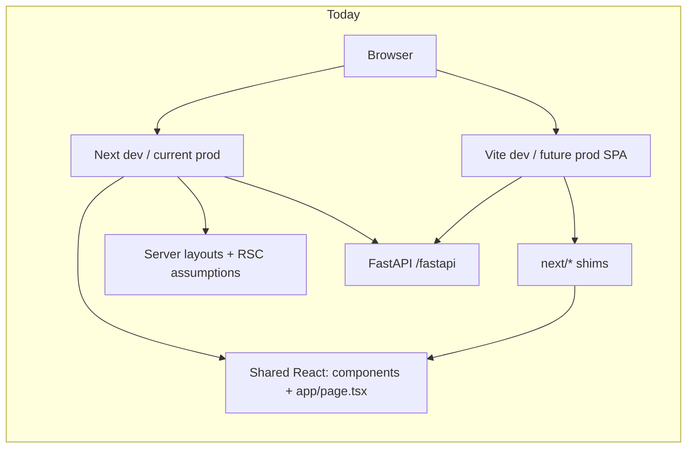

# Eliminating Next.js: where we are and cutover plan

Companion to [`vite_migration_plan.md`](./vite_migration_plan.md) and [`vite_route_manifest.md`](./vite_route_manifest.md).  
**Branch:** `vite` (Vite is **parallel**, not yet **authoritative** in deploy).

---

## Where we are (honest snapshot)

| Layer | Status | Notes |
|-------|--------|--------|
| **Product UI (browser)** | ~**95% routed on Vite** | `router.tsx` covers manifest ✅; rare org URLs → `OrgPlaceholderPage` 🔶 |
| **Auth / session** | **Backend-owned** | FastAPI cookie + OAuth; Next API routes for session/feedback **removed** |
| **Local dev default** | **Vite-first** | `make dev` → FastAPI + **Vite :5173**; Next :3000 only if **`DOCROUTER_DEV_NEXT=1`** |
| **CI** | **Hybrid** | `frontend-build.yml`: `typecheck` + **`build:vite`** (Next **`build`** not in CI) |
| **Release images** | **Vite SPA** | `release.yml` `target: **runner**` → `build:vite` + nginx (:80); legacy Next: `runner-next` |
| **Compose / K8s** | **Vite SPA** | Frontend container nginx :80; compose edge still **localhost:3000** → nginx → frontend:80 |
| **Vite production path** | **Default `runner`** | `Dockerfile` **`runner`** = `runner-vite` → `dist-vite/` + `nginx-spa.conf` |
| **`next` npm package** | **Still installed** | Required for `npm run dev` / `npm run build` (Next) until removal |
| **Source imports `next/*`** | **~90 files** | Mostly `next/link`, `next/navigation`; Vite **aliases** these to `src/shims/*` at build time |
| **Next-only server code** | **Small but real** | `layout.tsx` files use `getAppServerSession` / `redirect` / `cookies()` from `next/headers`; **Vite does not run these layouts** (CSR + `RequireAuth` instead) |
| **File layout** | **Still App Router** | **55** `page.tsx` under `src/app/`; Vite **imports them as components**, not as Next routes |

### Mental model

**Vite does not bundle the Next framework** for production SPA builds; it bundles **shared React code** and **replaces** `next/*` imports via `vite.config.ts` aliases. The **`next` dependency** remains for the **second** dev server and **default** Docker image.

---

## Why `next/*` still appears everywhere

1. **Migration strategy** — One codebase: pages live in `src/app/**/page.tsx` with Next-style imports; Vite mounts the same files through `router.tsx` + wrappers (`withRouteParams`, `OrgLayout`, …).
2. **Shims** — `next/link`, `next/navigation`, `next/dynamic`, `next/image` → `src/shims/*` (**Vite only**).
3. **Not yet refactored** — Replacing imports with `react-router-dom` and `` across ~90 files is Phase **C** below (after ops cutover).
4. **`src/app/` tree** — Next file conventions (`layout.tsx`, `page.tsx`) remain until pages move to a neutral folder (e.g. `src/pages/`).

---

## Production still on Next (checklist)

| Artifact | Next today | Change for Vite |
|----------|------------|-----------------|
| `deploy/shared/docker/Dockerfile` default `runner` | `npm run build` + standalone | Make **`runner-vite`** default **or** swap `runner` implementation |
| `.github/workflows/release.yml` | `target: runner` | `target: runner-vite` (+ tag naming if needed) |
| `deploy/compose/docker-compose.yml` | `command: node frontend/server.js` | nginx image, port **80**, drop `NEXTAUTH_URL` on frontend if unused |
| `deploy/compose/nginx.conf` | `proxy_pass http://frontend:3000/` | `frontend:80` (SPA); keep `/fastapi/` → backend |
| `deploy/charts/.../frontend/deployment.yaml` | port 3000, `node server.js` | port 80, nginx CMD, probe `/` |
| OAuth IdP callbacks | prod host + `/fastapi/.../callback` | Same URIs if origin unchanged; update **`app_origin`** / `NEXTAUTH_URL` / docs for single SPA origin |
| `tools/run-doc-router-docker.sh`, `docs/env.md` | `localhost:3000` | Document single UI URL |
| UI / E2E tests | may target 3000 | Retarget 5173 / compose URL |

Edge nginx already terminates **`/fastapi`**; the Vite **`nginx-spa.conf`** only needs to **`try_files`** for the SPA (no API proxy inside the frontend container).

---

## Plan to **completely eliminate** Next.js

Ordered so you can **ship Vite in prod** before **deleting** `next` from `package.json`.

### Phase A — Vite becomes the only **runtime** UI (keep Next in repo)

**Goal:** All deployed and local-default traffic uses the Vite build; Next is optional for comparison.

| # | Task | Exit criterion |
|---|------|----------------|
| A1 | Staging compose/K8s on `runner-vite` | Login, org workflows, settings, PDF, flows on staging URL — **verify on your staging host** |
| A2 | Switch `release.yml` + default compose **`build.target`** to `runner-vite` | ✅ `runner` = Vite SPA in Dockerfile + release |
| A3 | Helm chart: container port 80, drop `node server.js` | ✅ deployment/service/ingress → :80 |
| A4 | `start-all.sh` / `make dev`: default **`DOCROUTER_DEV_NEXT=0`** or remove Next from `start-all` | ✅ default Vite-only; `DOCROUTER_DEV_NEXT=1` opts into Next |
| A5 | Production OAuth: single **app origin** (no 3000) | IdP + `NEXTAUTH_URL` = **public** URL (compose: `http://localhost:3000` edge is fine) |
| A6 | Full regression matrix (copy smoke doc + customer-critical paths) | Signed-off checklist — **manual** |

**Do not** remove `next` from `package.json` yet — reduces risk.

---

### Phase B — CI and packaging only know Vite

| # | Task | Exit criterion |
|---|------|----------------|
| B1 | Remove `npm run build` / `next build` from Docker **frontend** stage used in releases | Dockerfile has one frontend build: `build:vite` |
| B2 | Delete **`runner`** (Node standalone) target or keep as deprecated one release | No production doc references `runner` |
| B3 | Optional: publish **`runner-vite`** as `doc-router-frontend` without rename | Same image name, new contents |
| B4 | `make build-vite` remains gate; add smoke job that serves `preview:vite` + curl | CI green |

---

### Phase C — Remove **shims** by fixing imports (source, not ops)

**Goal:** Shared code uses React Router and web APIs directly; `vite.config.ts` has **no** `next/*` aliases.

| # | Task | Exit criterion |
|---|------|----------------|
| C1 | Codemod `next/link` → `react-router-dom` `Link` (`to` prop) | `grep next/link` → 0 in `src/` |
| C2 | Codemod `next/navigation` → `react-router-dom` hooks (+ small `useAppRouter()` if needed) | `grep next/navigation` → 0 |
| C3 | Replace `next/dynamic` with `React.lazy` + `Suspense` at call sites | Delete `next-dynamic` shim |
| C4 | Replace `next/image` usages (already shimmed; 1–2 files) | Plain `` or shared `AppImage` |
| C5 | Remove **`redirect()`** from client pages; use `<Navigate>` or `useNavigate` | No `redirect` from `next/navigation` in client bundles |

**~90 files** — do in batches (components → app pages → settings).

---

### Phase D — Restructure away from App Router **filesystem**

| # | Task | Exit criterion |
|---|------|----------------|
| D1 | Move `src/app/**/page.tsx` → `src/pages/**` (or feature folders) | `src/app/` gone or docs-only |
| D2 | Delete unused **`layout.tsx`** server shells; keep layout **components** (`Layout`, `OrgLayout`, `SettingsAppLayout`) | No `getAppServerSession` in frontend |
| D3 | Delete `src/utils/session.ts` **server** path / `next/headers` usage | Session only via `AppSessionContext` + FastAPI |
| D4 | Consolidate routing in `router.tsx` (+ `lazy()` per route) | Single route table; manifest archived |
| D5 | Rename env: `NEXT_PUBLIC_*` → `VITE_*` (with compat `define` during transition) | `.env` docs updated |

---

### Phase E — Remove the **Next.js dependency**

| # | Task | Exit criterion |
|---|------|----------------|
| E1 | Remove `next`, `@types/next`, `eslint-config-next` from `package.json` | `npm install` clean |
| E2 | Delete `next.config.mjs`, `.next` gitignore-only, Next scripts (`dev`, `build`, `start`) | `package.json` scripts: `dev` → `vite`, `build` → `vite build` |
| E3 | ESLint: flat config without `eslint-config-next` | `npm run lint` passes |
| E4 | Remove Next-specific webpack workarounds duplicated in Vite where obsolete | Smaller config |
| E5 | Update **CLAUDE.md**, README, INSTALL.*, k8s/compose docs | No “Next.js frontend” as primary |
| E6 | Phase 6 checklist in `vite_migration_plan.md` — mark complete | PR merged to `main` |

---

## Suggested timeline (order of magnitude)

| Phase | Depends on | Rough effort |
|-------|------------|--------------|
| **A** Ops cutover | Manual smoke ✅, `build:vite` ✅ | **1–3 days** staging + prod flip |
| **B** CI/Docker | A stable on staging | **0.5–1 day** |
| **C** Import cleanup | A or B (can parallel after A1) | **3–7 days** (mechanical + test) |
| **D** Folder restructure | C largely done | **2–5 days** |
| **E** Dependency removal | D | **1–2 days** |

**“Next eliminated”** = end of **Phase E**. **“Next not in production”** = end of **Phase A** (users never hit Next; repo may still list `next` for a while).

---

## Immediate next actions (from current branch)

1. **Phase A1** — Compose experiment: `docker-compose` `frontend.build.target: runner-vite`, nginx upstream **:80**, regression on compose URL.
2. **Wire remaining 🔶 org routes** (if any found in daily use) — see route manifest.
3. **`preview:vite` + edge proxy** — confirm `PUBLIC_API_URL=/fastapi` in built `index.html` / env define for prod same-origin.
4. **Open tracking PR** — “Ops: switch frontend image to runner-vite” separate from “Remove next dependency” (Phase E).

---

## References

- Dev smoke: [`vite_smoke_test_5173.md`](./vite_smoke_test_5173.md)
- Route parity: [`vite_route_manifest.md`](./vite_route_manifest.md)
- Docker Vite target: `deploy/shared/docker/Dockerfile` (`runner-vite`), `packages/typescript/frontend/nginx-spa.conf`
- Shims: `packages/typescript/frontend/src/shims/`, aliases in `vite.config.ts`

*Last updated: branch `vite`, after Vite-only dev + production build smoke.*
