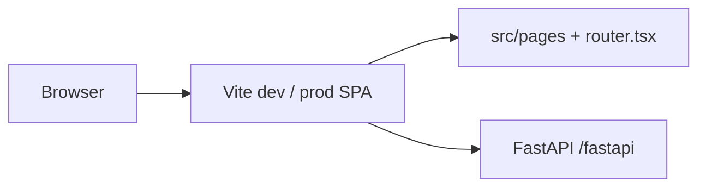

# Eliminating Next.js — complete

Companion to [`vite_migration_plan.md`](./vite_migration_plan.md) and [`vite_route_manifest.md`](./vite_route_manifest.md).

**Status:** **Closed** — merged to **`main`**. Phases **A–E** finished; `next` removed from `package.json`; UI is Vite-only.

**Next frontend initiative:** [`design/ui-migration.md`](./design/ui-migration.md).

---

## Final snapshot

| Layer | Outcome |
|-------|---------|
| **Browser UI** | Vite SPA — `router.tsx`, lazy `src/pages/**` |
| **Auth / API** | FastAPI only (session cookie, feedback, OAuth); no Next route handlers |
| **Local dev** | `make dev` → `:5173` + `/fastapi` proxy |
| **CI / images** | `npm run typecheck` + `npm run build`; nginx serves `dist-vite/` |
| **Source** | No `next/*` imports; no `src/app/` tree |

---

## Phase sign-off (historical)

| Phase | Summary | Status |
|-------|---------|--------|
| **A** | Vite sole runtime UI (compose, Helm, default dev) | ✅ |
| **B** | Docker/CI/release Vite-only builds | ✅ |
| **C** | React Router replacements for `next/*` client APIs | ✅ |
| **D** | `src/pages/**`, lazy routes, `VITE_*` / `publicEnv.ts` | ✅ |
| **E** | Remove `next`, delete App Router, ESLint, docs/tooling | ✅ |

---

## Maintenance (not migration work)

- **Per-environment smoke** after deploy: login, PDF, flows, flow OAuth popup — [`vite_smoke_test_5173.md`](./vite_smoke_test_5173.md).
- **IdP redirect URIs** must match each deployment’s public origin (and **5173** for local Vite dev).
- Optional naming cleanup: `NEXTAUTH_URL` → `APP_URL` in ops docs only (behavior unchanged).

---

## References

- Routes: [`vite_route_manifest.md`](./vite_route_manifest.md)
- Docker: `deploy/shared/docker/Dockerfile` (`frontend` → `runner`), `nginx-spa.conf`
- App navigation: `packages/typescript/frontend/src/utils/appRouter.ts`

*Last updated: migration closed on `main`; UI migration is the active plan.*
